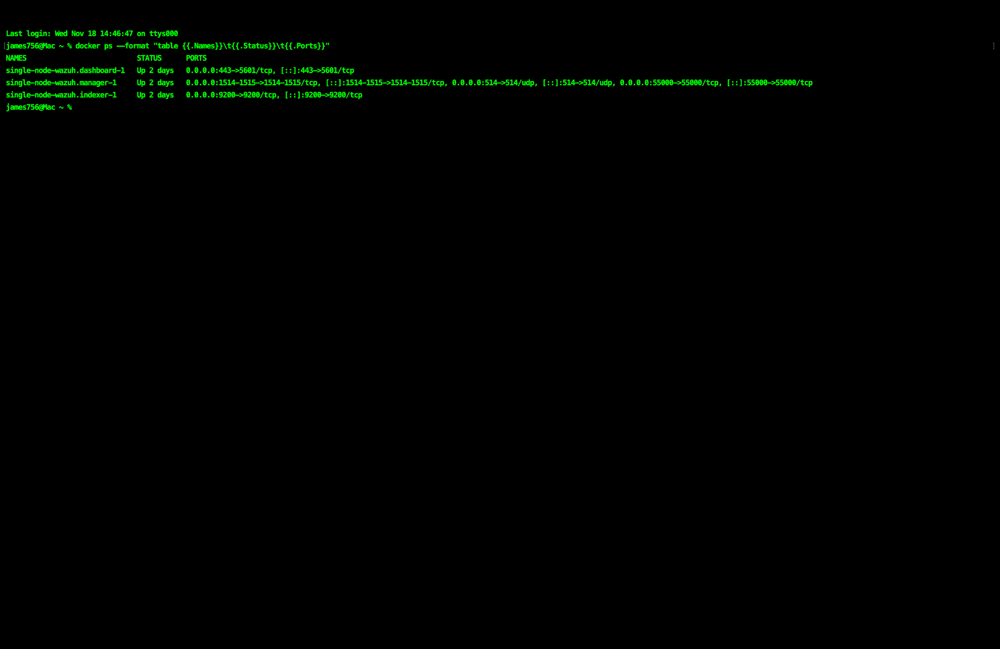

# Module 01: Architecture and Deployment Validation

**Project:** [Wazuh Operations Lab](../README.md)  
**Environment:** Wazuh 4.14.6 | Docker | Windows 11  
**Status:** Completed  
**Assessment:** Demonstrated within the tested scope  
**Validation Date:** November 19, 2026

## 1. Objective

Validate the existing Wazuh deployment and establish a monitoring baseline before beginning operational troubleshooting.

The exercise focused on five checkpoints:

1. Verify the Wazuh container runtime.
2. Confirm Dashboard accessibility.
3. Verify Windows agent connectivity.
4. Confirm Windows Security event ingestion.
5. Validate Wazuh rule processing.

Each checkpoint was assessed independently using actual laboratory evidence.

## 2. Lab Environment

| Component | Configuration |
|---|---|
| Host | MacBook Air M2 |
| Operating System | macOS |
| Container Platform | Docker |
| Wazuh Deployment | Single node |
| Wazuh Version | 4.14.6 |
| Components | Manager, Indexer, Dashboard |
| Endpoint | Windows 11 ARM64 |
| Hostname | WIN-SOC |
| Endpoint IP | 192.168.64.20 |
| Wazuh Agent | 4.14.9 |
| Agent ID | 004 |

### Monitoring Architecture

```text
MacBook Air M2
│
├── Docker
│   ├── Wazuh Manager
│   ├── Wazuh Indexer
│   └── Wazuh Dashboard
│
└── Windows 11 VM
    └── WIN-SOC
        ├── Wazuh Agent 004
        ├── Windows Security Events
        ├── Windows System Events
        ├── Windows Application Events
        └── Sysmon Operational Events
```

The Windows agent forwards endpoint telemetry to the Wazuh Manager.

The Manager processes collected events using configured decoders and rules. Generated alerts can then be indexed and accessed through the Wazuh Dashboard.

## 3. Deployment Validation

### Check 01: Docker Container Runtime

**Objective:** Confirm that the required Wazuh containers were running.

**Action:**

```bash
docker ps --format "table {{.Names}}\t{{.Status}}\t{{.Ports}}"
```

**Observed Results:**

| Component | Status |
|---|---|
| Wazuh Manager | Up |
| Wazuh Indexer | Up |
| Wazuh Dashboard | Up |

All three containers reported running states.

**Evidence M01-E01:**



**Observation:** The Manager, Indexer, and Dashboard containers were running during inspection.

**Interpretation:** The required Wazuh components were available at the Docker runtime level.

**Limitation:** Running containers do not independently establish complete application health.

### Check 02: Dashboard Accessibility

**Objective:** Verify that the Wazuh Dashboard was accessible.

**Action:**

Accessed the Dashboard through the browser and inspected the available monitoring interfaces.

**Observed Results:**

1. The Dashboard interface loaded.
2. Agent management was accessible.
3. WIN-SOC monitoring information was displayed.
4. Threat Hunting was accessible.

**Interpretation:** The Dashboard was available for the monitoring and investigation activities performed.

**Evidence:** Dashboard accessibility is also demonstrated in the agent and event screenshots below.

**Limitation:** Dashboard accessibility alone does not establish complete backend service health.

### Check 03: Windows Agent Connectivity

**Objective:** Verify that WIN-SOC was communicating with the Wazuh Manager.

**Action:**

Inspected WIN-SOC through the Wazuh agent management interface.

**Observed Results:**

| Field | Value |
|---|---|
| Agent Name | WIN-SOC |
| Agent ID | 004 |
| IP Address | 192.168.64.20 |
| Operating System | Windows 11 |
| Agent Version | 4.14.9 |
| Status | Active |
| Keepalive | Recent at inspection |

**Evidence M01-E02:**


**Observation:** WIN-SOC reported Active with a recent keepalive.

**Interpretation:** The Manager recognized the Windows endpoint as connected.

**Limitation:** Agent connectivity does not prove that every intended event source is configured or collected.

### Check 04: Windows Security Event Ingestion

**Objective:** Verify that Windows Security telemetry was reaching Wazuh and being processed.

**Action:**

Inspected Windows Security events using Wazuh Threat Hunting.

**Observed Results:**

| Field | Value |
|---|---|
| Agent | WIN-SOC |
| Agent ID | 004 |
| Event Channel | Security |
| Windows Event ID | 4688 |
| Event Record ID | 81093 |
| Description | A new process has been created |
| Wazuh Rule ID | 67027 |
| Rule Level | 3 |
| Decoder | windows_eventchannel |

**Evidence M01-E03:**


**Observation:** Wazuh displayed a structured Windows Security Event ID 4688 containing process creation information.

**Interpretation:** Windows Security process creation telemetry was successfully received and available for investigation.

### Check 05: Wazuh Rule Processing

**Objective:** Confirm that the collected event was processed by a Wazuh detection rule.

**Action:**

Examined the rule information associated with the inspected Windows Security event.

**Observed Results:**

| Field | Value |
|---|---|
| Rule ID | 67027 |
| Rule Level | 3 |
| Description | A process was created |
| Rule Groups | windows, WEF |
| Decoder | windows_eventchannel |

**Evidence M01-E04:**


**Observation:** Wazuh associated the inspected process creation event with Rule 67027.

**Interpretation:** The event was decoded, processed by a rule, and retrievable through the investigation interface.

**Limitation:** The record confirms event processing, not malicious activity or complete Windows telemetry coverage.

## 4. Evidence Index

| Evidence ID | Description | Verified Finding |
|---|---|---|
| M01-E01 | [Container Runtime](evidence/m01-01-wazuh-containers-running.png) | Three Wazuh containers running |
| M01-E02 | [Agent Connectivity](evidence/m01-02-win-soc-agent-active.png) | WIN-SOC Agent 004 Active |
| M01-E03 | [Windows Event 4688](evidence/m01-03-windows-event-4688.png) | Security event ingestion confirmed |
| M01-E04 | [Wazuh Rule 67027](evidence/m01-04-wazuh-rule-67027.png) | Rule processing confirmed |

### Evidence Integrity

All evidence originates from the actual home lab.

Screenshots are used to support specific observations without reconstructing or fabricating results.

The findings distinguish container availability, agent connectivity, event ingestion, and rule processing.

## 5. Findings

### Finding 01: Container Runtime Availability

The three required Wazuh containers reported running states.

This confirmed Docker runtime availability during the inspection.

### Finding 02: Dashboard Accessibility

The Dashboard was accessible and allowed navigation through the monitoring interfaces used during validation.

### Finding 03: Windows Agent Connectivity

WIN-SOC Agent 004 reported Active with a recent keepalive.

This confirmed the endpoint's connected state at inspection.

### Finding 04: Security Event Ingestion

Windows Security Event ID 4688 was retrieved through Wazuh Threat Hunting.

The record contained structured process creation information.

### Finding 05: Rule Processing

The inspected Windows event was associated with Wazuh Rule 67027 at level 3.

This confirmed processing of the inspected event by a Wazuh rule.

## 6. Operational Lessons

### Container Availability Does Not Establish Complete Health

Docker runtime status provides an initial operational checkpoint.

Additional application and telemetry checks are necessary before making broader health claims.

### Agent Connectivity Does Not Guarantee Telemetry Coverage

An Active agent may still have missing or incorrectly configured event collectors.

Log source validation must be performed separately.

### Event Ingestion Requires Direct Evidence

Retrieving the actual Windows event provides stronger evidence than relying only on agent connection status.

### Event Collection and Detection Are Different

A collected event does not necessarily generate an alert.

In this exercise, the inspected Windows Event ID 4688 was both collected and processed by Rule 67027.

### Evidence Determines the Assessment

The investigation distinguishes three categories:

**Observed:** Information directly recorded by the system.

**Interpretation:** Conclusions supported by the observations.

**Unknown:** Conditions not established by available evidence.

## 7. Outcome and Assessment

**Practical Result:** Completed

**Assessment:** Demonstrated within the tested scope

### Demonstrated Competencies

1. Docker container runtime inspection
2. Wazuh component identification
3. Dashboard accessibility verification
4. Windows agent connectivity verification
5. Windows Security event ingestion validation
6. Wazuh rule processing verification
7. Evidence based operational documentation

### Limitations

The exercise did not establish:

1. Comprehensive Wazuh application health
2. Production availability or resilience
3. Complete Windows telemetry coverage
4. High availability or clustering
5. Continuous monitoring performance
6. Enterprise deployment readiness

### Final Assessment

Module 01 established a verified operational baseline for the single node Wazuh environment.

The evidence confirms that the required containers were running, the Dashboard was accessible, WIN-SOC was connected, and the inspected Windows Security event was processed and retrievable.

These findings support baseline monitoring functionality within the tested environment.

**Module 01 Status: Completed**

## 8. Repository Navigation

**Project Home:** [Wazuh Operations Lab](../README.md)

**Next Module:** Windows Agent Management and Troubleshooting

Module 02 builds on the established baseline by examining a controlled Wazuh agent service interruption and recovery.
