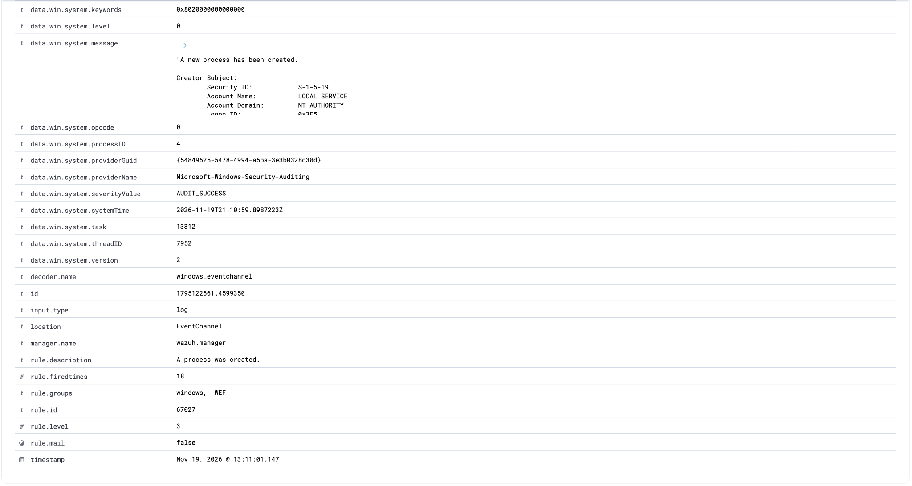

# Module 01 — Architecture and Deployment Validation

**Project:** [Wazuh Operations Lab](../README.md)  
**Environment:** Wazuh 4.14.6 | Docker | Windows 11  
**Status:** Completed  
**Assessment:** Demonstrated within the tested scope  
**Validation date:** November 19, 2026

---

## 1. Objective

Validate the existing Wazuh deployment and establish an operational monitoring baseline before beginning troubleshooting exercises.

The objective was to independently verify:

- Wazuh Manager, Indexer, and Dashboard container status
- Wazuh Dashboard accessibility
- Windows endpoint agent connectivity
- Windows Security event ingestion
- Wazuh rule processing and event retrieval

The validation follows an evidence-first approach. A running container, accessible Dashboard, or connected agent is not automatically proof of complete monitoring health.

---

## 2. Lab Environment

| Component | Configuration |
|---|---|
| Host | MacBook Air M2 |
| Operating system | macOS |
| Container platform | Docker |
| Wazuh deployment | Single-node |
| Wazuh version | 4.14.6 |
| Wazuh components | Manager, Indexer, Dashboard |
| Endpoint | Windows 11 ARM64 |
| Endpoint hostname | WIN-SOC |
| Endpoint IP | 192.168.64.20 |
| Wazuh Agent | 4.14.9 |
| Agent ID | 004 |
| Telemetry | Windows Event Logs, Sysmon |

### Monitoring Architecture

```text
MacBook Air M2 — macOS
│
├── Docker
│   ├── Wazuh Manager 4.14.6
│   ├── Wazuh Indexer 4.14.6
│   └── Wazuh Dashboard 4.14.6
│
└── Windows 11 ARM64 VM
    └── WIN-SOC
        ├── Wazuh Agent 4.14.9
        ├── Windows Security Events
        ├── Windows System Events
        ├── Windows Application Events
        └── Sysmon Operational Events
```

The Windows agent collects endpoint telemetry and forwards it to the Wazuh Manager.

The Manager processes events using configured decoders and detection rules. Processed alerts can subsequently be indexed and investigated through the Wazuh Dashboard.

**Scope:** A single Windows endpoint in an independent home-lab environment.

---

## 3. Baseline Validation

### Check 01 — Wazuh Container Runtime

**Objective:** Confirm that the required Wazuh containers are running.

**Action performed:**

Inspected Docker container status from macOS Terminal.

```bash
docker ps --format "table {{.Names}}\t{{.Status}}\t{{.Ports}}"
```

**Observed results:**

| Container | Observed status |
|---|---|
| single-node-wazuh.manager-1 | Up |
| single-node-wazuh.indexer-1 | Up |
| single-node-wazuh.dashboard-1 | Up |

All three containers reported running states during the inspection.

#### Evidence M01-E01 — Container Runtime


**Observation:** Docker reported the Wazuh Manager, Indexer, and Dashboard containers as running.

**Interpretation:** The three required Wazuh containers were available at the container runtime level.

**Limitation:** A Docker `Up` status does not independently prove that every application service is healthy or that the deployment is production-ready.

---

### Check 02 — Wazuh Dashboard Accessibility

**Objective:** Verify that the Wazuh Dashboard can be accessed for monitoring and investigation.

**Action performed:**

Opened the Wazuh Dashboard and navigated through the available monitoring interfaces.

**Observed results:**

- The Dashboard interface loaded successfully.
- The agent management interface was accessible.
- WIN-SOC monitoring information could be viewed.
- Threat Hunting was available for inspecting security alerts.

**Interpretation:** The Dashboard was accessible and supported the monitoring and investigation functions exercised during validation.

**Evidence:** Dashboard accessibility is also demonstrated in M01-E02, M01-E03, and M01-E04 below.

**Limitation:** An accessible Dashboard does not establish comprehensive backend health or guarantee that every intended event source is functioning.

---

### Check 03 — Windows Agent Connectivity

**Objective:** Confirm that the monitored Windows endpoint is connected to Wazuh.

**Action performed:**

Opened the Wazuh agent management interface and inspected WIN-SOC.

**Observed results:**

| Field | Verified value |
|---|---|
| Agent name | WIN-SOC |
| Agent ID | 004 |
| Agent IP | 192.168.64.20 |
| Operating system | Windows 11 |
| Agent version | 4.14.9 |
| Agent status | Active |
| Last keepalive | Recent at inspection |

#### Evidence M01-E02 — WIN-SOC Agent Status


**Observation:** WIN-SOC, Agent ID 004, reported `Active` and displayed a recent keepalive timestamp.

**Interpretation:** The Wazuh Manager recognized the endpoint as connected at the time of inspection.

**Limitation:** An Active agent does not establish that all configured event sources are being collected or that telemetry coverage is complete.

This distinction becomes important in Module 03, where a missing PowerShell Operational event collector was identified and corrected.

---

### Check 04 — Windows Security Event Ingestion

**Objective:** Confirm that Windows Security telemetry is received, processed, and retrievable through Wazuh.

**Action performed:**

Opened Wazuh Threat Hunting and inspected an individual Windows Security process-creation event.

**Observed event details:**

| Field | Verified value |
|---|---|
| Agent | WIN-SOC |
| Agent ID | 004 |
| Windows event channel | Security |
| Windows Event ID | 4688 |
| Event Record ID | 81093 |
| Event description | A new process has been created |
| Wazuh Rule ID | 67027 |
| Rule description | A process was created |
| Rule level | 3 |
| Decoder | windows_eventchannel |

#### Evidence M01-E03 — Windows Security Event 4688


**Observation:** Wazuh displayed a structured Windows Security Event ID 4688 associated with WIN-SOC.

The event contained process-creation information, including executable and parent-process fields.

**Interpretation:** Windows Security process-creation telemetry was successfully collected and made available for investigation.

#### Evidence M01-E04 — Wazuh Rule Processing



**Observation:** The event was associated with Wazuh Rule ID 67027, level 3, with the description `A process was created.`

The record also identified the `windows_eventchannel` decoder.

**Interpretation:** The inspected Windows event was decoded, processed by a Wazuh rule, and available as an alert record.

This provides stronger evidence of the tested telemetry pipeline than agent connectivity alone.

**Limitation:** The observation confirms ingestion and processing for the inspected event. It does not prove complete coverage of all Windows Security events or establish that the activity was malicious.

---

## 4. Evidence Index

The following genuine screenshots document the completed validation.

| Evidence ID | Evidence | Technical claim supported |
|---|---|---|
| M01-E01 | [Docker Container Runtime](evidence/m01-01-wazuh-containers-running.png) | Manager, Indexer, and Dashboard containers were running |
| M01-E02 | [WIN-SOC Agent Connectivity](evidence/m01-02-win-soc-agent-active.png) | Agent 004 reported Active with recent keepalive |
| M01-E03 | [Windows Event ID 4688](evidence/m01-03-windows-event-4688.png) | Windows Security process-creation event was retrieved |
| M01-E04 | [Wazuh Rule 67027](evidence/m01-04-wazuh-rule-67027.png) | The inspected event was processed by Wazuh |

### Evidence Handling

All evidence originates from actual laboratory observations.

- No screenshots were generated or reconstructed.
- Screenshots support only the claims visible in their contents.
- Agent connectivity, event ingestion, and rule processing are assessed separately.
- The evidence represents the observed state during testing, not a guarantee of continuous operational availability.

### Evidence Directory

```text
module-01-architecture-deployment/
├── README.md
└── evidence/
    ├── m01-01-wazuh-containers-running.png
    ├── m01-02-win-soc-agent-active.png
    ├── m01-03-windows-event-4688.png
    └── m01-04-wazuh-rule-67027.png
```

---

## 5. Findings

The exercise established four important operational findings.

### Finding 01 — Required Wazuh Containers Were Running

The Manager, Indexer, and Dashboard containers reported running states.

This established container-level availability during the inspection.

### Finding 02 — Dashboard Access Was Available

The Wazuh Dashboard was accessible and supported the monitoring activities performed during validation.

### Finding 03 — WIN-SOC Was Connected

Wazuh Agent 004 reported Active with a recent keepalive.

This established agent connectivity at the time of inspection.

### Finding 04 — Windows Security Telemetry Was Processed

Windows Security Event ID 4688 was retrieved through Threat Hunting and associated with Wazuh Rule 67027.

This confirmed event ingestion and rule processing for the inspected record.

---

## 6. Operational Lessons

### Container Availability Is Not Application Health

A running Docker container is a useful first checkpoint, but it does not independently verify the health of every application component.

### Agent Connectivity Is Not Complete Telemetry Coverage

An Active agent demonstrates connectivity, not complete monitoring coverage.

Individual log sources and event channels require separate validation.

### Event Reception and Alert Generation Are Distinct

A collected event may not generate an alert unless the applicable rule conditions are satisfied.

For this exercise, Windows Event ID 4688 was both received and associated with a Wazuh alert rule.

### Evidence Determines the Conclusion

Operational assessments should distinguish:

**Observed:** What the system actually reported.

**Interpretation:** What the observation reasonably supports.

**Unknown:** What the available evidence does not establish.

This prevents overstating the outcome of a successful command, connection, or dashboard check.

---

## 7. Outcome and Assessment

**Practical result:** Completed.

**Assessment:** Demonstrated within the tested scope.

### Competencies Demonstrated

- Docker container runtime inspection
- Wazuh component identification
- Wazuh Dashboard accessibility verification
- Windows endpoint agent connectivity verification
- Windows Security event ingestion validation
- Wazuh event decoding and rule-processing verification
- Evidence-based operational documentation

### Not Established

- Comprehensive Wazuh service health
- Production availability or resilience
- Complete endpoint telemetry coverage
- High availability or clustering
- Continuous monitoring performance
- Enterprise-scale deployment readiness

### Final Assessment

The exercise established a verified operational baseline for the existing single-node Wazuh deployment and WIN-SOC endpoint.

The results support container runtime availability, Dashboard accessibility, agent connectivity, and ingestion and processing of the inspected Windows Security event.

The observations do not establish comprehensive platform health or production readiness.

**Module 01 status: Completed.**

---

## 8. Related Modules

### Module 02 — Windows Agent Management and Troubleshooting

The next exercise builds on the established baseline by introducing a controlled Windows agent service interruption.

It evaluates service state, recovery, and subsequent endpoint connectivity.

The exercise is documented separately to preserve a clear distinction between deployment validation and incident troubleshooting.

---

[← Back to Wazuh Operations Lab](../README.md)
