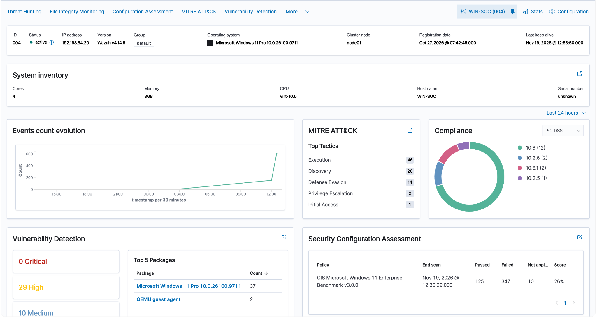
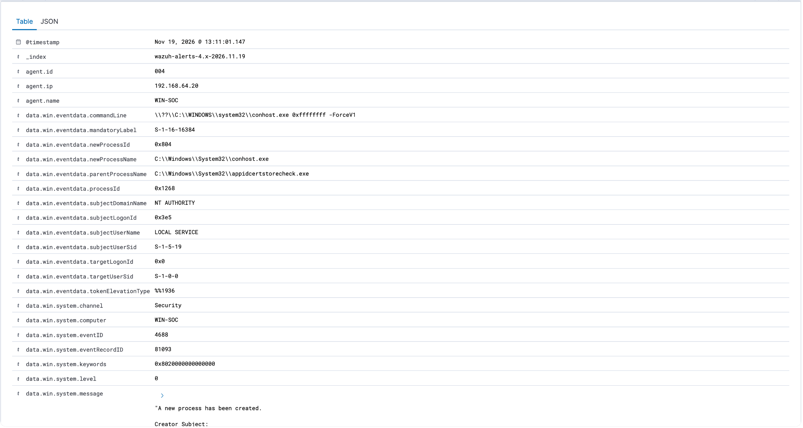

# Module 01: Architecture and Deployment Validation

**Project:** [Wazuh Operations Lab](../README.md)  
**Environment:** Wazuh 4.14.6 | Docker | Windows 11  
**Status:** Completed  
**Assessment:** Demonstrated within the tested scope  
**Validation Date:** November 19, 2026

## 1. Objective

Establish a verified operational baseline for the existing Wazuh deployment before performing troubleshooting exercises.

The validation focused on five operational checks:

1. Confirm Wazuh container runtime availability.
2. Verify Dashboard accessibility.
3. Confirm Windows agent connectivity.
4. Validate Windows Security event ingestion.
5. Verify Wazuh rule processing.

Each check was assessed using observed laboratory evidence.

## 2. Lab Environment

| Component | Configuration |
|---|---|
| Host | MacBook Air M2 |
| Operating System | macOS |
| Container Platform | Docker |
| Wazuh Deployment | Single node |
| Wazuh Version | 4.14.6 |
| Wazuh Components | Manager, Indexer, Dashboard |
| Endpoint | Windows 11 ARM64 |
| Hostname | WIN-SOC |
| Endpoint IP | 192.168.64.20 |
| Wazuh Agent | 4.14.9 |
| Agent ID | 004 |

### Monitoring Architecture

```text
MacBook Air M2
│
├── Docker
│   ├── Wazuh Manager
│   ├── Wazuh Indexer
│   └── Wazuh Dashboard
│
└── Windows 11 ARM64 VM
    └── WIN-SOC
        ├── Wazuh Agent 004
        ├── Windows Security Events
        ├── Windows System Events
        ├── Windows Application Events
        └── Sysmon Operational Events
```

The Windows agent collects endpoint telemetry and forwards it to the Wazuh Manager.

The Manager processes received events using configured decoders and rules. Generated alerts can be indexed and investigated through the Wazuh Dashboard.

**Scope:** One monitored Windows endpoint in an independent home lab.

## 3. Deployment Validation

### Check 01: Wazuh Container Runtime

**Objective:** Verify that the required Wazuh containers were running.

**Action:** Inspected the Wazuh Docker containers using:

```bash
docker ps
```

**Observed:**

| Container | Status |
|---|---|
| single-node-wazuh.manager-1 | Up |
| single-node-wazuh.indexer-1 | Up |
| single-node-wazuh.dashboard-1 | Up |

**Evidence M01-E01: Wazuh Container Runtime**


**Observation:** All three Wazuh containers reported running states.

**Interpretation:** The Wazuh components were available at the Docker runtime level.

**Limitation:** Container status does not independently establish complete application health or production readiness.

### Check 02: Dashboard Accessibility

**Objective:** Confirm that the Wazuh Dashboard was accessible.

**Action:** Opened the Wazuh Dashboard through the browser and inspected the monitoring interfaces.

**Observed:**

1. The Dashboard loaded successfully.
2. Agent management was accessible.
3. WIN-SOC agent details were displayed.
4. Threat Hunting was accessible for event investigation.

**Evidence:** Dashboard accessibility is supported by screenshots M01-E02, M01-E03 and M01-E04.

**Interpretation:** The Dashboard was available for the monitoring and investigation activities performed.

**Limitation:** Dashboard access does not independently prove full backend service health.

### Check 03: Windows Agent Connectivity

**Objective:** Verify that WIN-SOC was connected to the Wazuh Manager.

**Action:** Inspected the endpoint through Wazuh agent management.

**Observed:**

| Field | Value |
|---|---|
| Agent Name | WIN-SOC |
| Agent ID | 004 |
| IP Address | 192.168.64.20 |
| Operating System | Windows 11 |
| Agent Version | 4.14.9 |
| Agent Status | Active |
| Last Keepalive | Recent at inspection |

**Evidence M01-E02: WIN-SOC Agent Connectivity**



**Observation:** WIN-SOC reported Active with a recent keepalive.

**Interpretation:** The Manager recognized WIN-SOC as connected at the time of inspection.

**Limitation:** An Active agent does not prove that every intended Windows event source is configured or being collected.

### Check 04: Windows Security Event Ingestion

**Objective:** Validate that Windows Security telemetry was received and available for investigation.

**Action:** Inspected a Windows Security process creation event through Wazuh Threat Hunting.

**Observed:**

| Field | Value |
|---|---|
| Agent | WIN-SOC |
| Agent ID | 004 |
| Event Channel | Security |
| Windows Event ID | 4688 |
| Event Record ID | 81093 |
| Event Description | A new process has been created |
| Decoder | windows_eventchannel |

**Evidence M01-E03: Windows Security Event 4688**



**Observation:** Wazuh displayed a structured Windows Security Event ID 4688 containing process creation information.

**Interpretation:** The inspected Windows Security event was successfully collected and retrievable.

**Limitation:** One successfully received event does not establish complete Windows Security event coverage.

### Check 05: Wazuh Rule Processing

**Objective:** Verify that the collected event was processed by a Wazuh rule.

**Action:** Inspected the rule metadata associated with the Windows Security event.

**Observed:**

| Field | Value |
|---|---|
| Wazuh Rule ID | 67027 |
| Rule Level | 3 |
| Rule Description | A process was created |
| Decoder | windows_eventchannel |

**Evidence M01-E04: Wazuh Rule 67027**


**Observation:** The inspected event was associated with Wazuh Rule 67027 at level 3.

**Interpretation:** The event was decoded, processed by a Wazuh rule, and available through Threat Hunting.

**Limitation:** Process creation alone does not establish malicious activity.

## 4. Evidence Index

| Evidence ID | Screenshot | Finding |
|---|---|---|
| M01-E01 | [Container Runtime](evidence/m01-01-wazuh-containers-running.png) | Three Wazuh containers running |
| M01-E02 | [WIN-SOC Agent Status](evidence/m01-02-win-soc-agent-active.png) | Agent 004 Active |
| M01-E03 | [Windows Event 4688](evidence/m01-03-windows-event-4688.png) | Windows Security event ingestion verified |
| M01-E04 | [Wazuh Rule 67027](evidence/m01-04-wazuh-rule-67027.png) | Event processing verified |

### Evidence Integrity

All screenshots originate from the actual lab.

Each screenshot supports a specific technical observation. No reconstructed or generated evidence is used.

The findings distinguish container availability, Dashboard access, endpoint connectivity, event ingestion, and rule processing.

### Evidence Directory

```text
module-01-architecture-deployment/
├── README.md
├── investigation_notes.md
└── evidence/
    ├── m01-01-wazuh-containers-running.png
    ├── m01-02-win-soc-agent-active.png
    ├── m01-03-windows-event-4688.png
    └── m01-04-wazuh-rule-67027.png
```

## 5. Findings

### Finding 01: Container Runtime

The Wazuh Manager, Indexer, and Dashboard containers reported running states.

This established runtime availability during the inspection.

### Finding 02: Dashboard Access

The Dashboard was accessible and supported the monitoring interfaces used during validation.

### Finding 03: Agent Connectivity

WIN-SOC Agent 004 reported Active with a recent keepalive.

This confirmed the endpoint's connected state at inspection.

### Finding 04: Windows Security Event Ingestion

Windows Security Event ID 4688 was available through Threat Hunting.

The record contained structured process creation fields.

### Finding 05: Rule Processing

Wazuh Rule 67027 processed the inspected Windows Security event at level 3.

This confirmed event processing for the selected record.

## 6. Operational Lessons

### Container Availability Is Not Complete Application Health

Docker runtime status provides an initial operational checkpoint.

Additional application checks are required before making broader health claims.

### Agent Connectivity Is Not Complete Telemetry Coverage

An Active endpoint may still have missing event collectors.

Individual log sources require separate verification.

### Actual Event Records Provide Stronger Evidence

Retrieving a Windows Security event confirms more than agent connectivity alone.

The inspected event established that Windows Security telemetry reached Wazuh and was available for investigation.

### Event Ingestion and Rule Processing Are Separate Checks

Event collection alone does not guarantee an alert.

For the inspected Event ID 4688, Wazuh Rule 67027 processing was independently observed.

### Evidence Determines the Conclusion

**Observed:** Information directly recorded by the system.

**Interpretation:** Conclusions supported by the observations.

**Unknown:** Conditions not established by the available evidence.

## 7. Outcome and Assessment

**Practical Result:** Completed

**Assessment:** Demonstrated within the tested scope

### Competencies Demonstrated

1. Docker container runtime inspection
2. Wazuh component identification
3. Wazuh Dashboard accessibility verification
4. Windows agent connectivity verification
5. Windows Security event ingestion validation
6. Wazuh rule processing verification
7. Evidence based operational documentation

### Limitations

The exercise did not establish:

1. Comprehensive Wazuh application health
2. Production availability or resilience
3. Complete Windows telemetry coverage
4. High availability or clustering
5. Continuous monitoring performance
6. Enterprise deployment readiness

### Final Assessment

Module 01 established a verified operational baseline for the single node Wazuh deployment.

The evidence confirms that the required containers were running, the Dashboard was accessible, WIN-SOC was connected, and the inspected Windows Security event was processed and retrievable.

These observations support baseline monitoring functionality within the tested environment.

**Module 01 Status: Completed**

## 8. Repository Navigation

[Project Home](../README.md) | [Continue to Module 02](../module-02-agent-troubleshooting/README.md)
