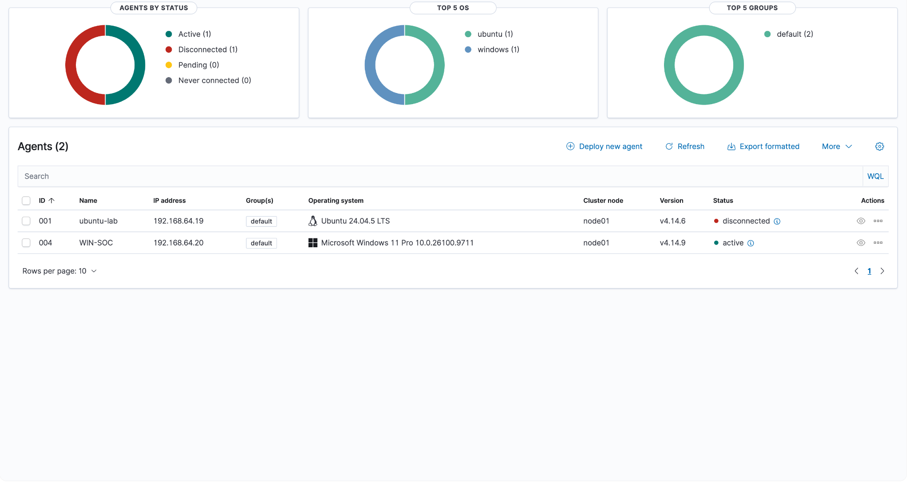

# Module 02: Windows Agent Management and Troubleshooting

**Project:** [Wazuh Operations Lab](../README.md)  
**Environment:** Wazuh 4.14.6 | Docker | Windows 11  
**Status:** Completed  
**Assessment:** Demonstrated within the tested scope  
**Validation Date:** November 19, 2026

## 1. Objective

Investigate and recover from a controlled Wazuh Windows agent service interruption.

The exercise focused on five operational checks:

1. Establish the Windows agent service baseline.
2. Introduce a controlled service interruption.
3. Verify the service entered the Stopped state.
4. Restore the agent service.
5. Confirm service recovery and Manager connectivity.

The objective was to demonstrate a repeatable troubleshooting process using actual Windows service observations and Wazuh Dashboard evidence.

## 2. Lab Environment

| Component | Configuration |
|---|---|
| Host | MacBook Air M2 |
| Operating System | macOS |
| Container Platform | Docker |
| Wazuh Deployment | Single node |
| Wazuh Version | 4.14.6 |
| Wazuh Components | Manager, Indexer, Dashboard |
| Endpoint | Windows 11 ARM64 |
| Hostname | WIN-SOC |
| Endpoint IP | 192.168.64.20 |
| Wazuh Agent | 4.14.9 |
| Agent ID | 004 |
| Windows Service | WazuhSvc |

### Troubleshooting Scope

The exercise examined the Windows agent service and its subsequently reported Manager connectivity.

The interruption was intentional and performed within the independent home lab.

No production endpoint, customer system, or live security incident was involved.

## 3. Agent Troubleshooting

### Check 01: Windows Agent Service Baseline

**Objective:** Establish the agent service state before introducing the controlled failure.

**Action:** Opened Windows PowerShell on WIN-SOC and inspected the Wazuh service.

```powershell
Get-Service -Name WazuhSvc
```

**Observed Results:**

| Field | Value |
|---|---|
| Service Name | WazuhSvc |
| Display Name | Wazuh |
| Service Status | Running |

**Evidence M02-E01: Initial Service State**


**Observation:** The WazuhSvc service reported Running before the interruption.

**Interpretation:** The Windows agent service was running at the beginning of the test.

**Limitation:** A Running service does not independently prove that the agent is connected to its Manager or forwarding telemetry.

### Check 02: Controlled Service Interruption

**Objective:** Introduce a known operational failure for troubleshooting.

**Action:** Stopped the Windows Wazuh agent service.

```powershell
Stop-Service -Name WazuhSvc
```

The command completed without a visible error.

The service state was then checked independently.

```powershell
Get-Service -Name WazuhSvc
```

**Observed Results:**

| Field | Value |
|---|---|
| Service Name | WazuhSvc |
| Service Status | Stopped |
| Failure Type | Controlled service interruption |

**Evidence M02-E02: Service Stopped**


**Observation:** Windows reported WazuhSvc as Stopped after the controlled interruption.

**Interpretation:** The service interruption was successfully established and verified at the endpoint.

**Limitation:** The Manager's Disconnected state was not captured during this interval.

The Windows service state confirms the local interruption. It does not independently establish when the Manager detected or reported the connectivity loss.

### Check 03: Agent Service Recovery

**Objective:** Restore the Windows Wazuh agent service after the controlled interruption.

**Action:** Started WazuhSvc using PowerShell.

```powershell
Start-Service -Name WazuhSvc
```

The command completed without a visible error.

Service recovery was then checked.

```powershell
Get-Service -Name WazuhSvc
```

**Observed Results:**

| Field | Value |
|---|---|
| Service Name | WazuhSvc |
| Service Status | Running |
| Recovery Action | Start-Service |

**Evidence M02-E03: Service Recovery**


**Observation:** WazuhSvc reported Running following the recovery action.

**Interpretation:** The Windows service was successfully restored.

**Limitation:** A successful service restart alone does not establish that the Manager has resumed communication with the agent.

Manager connectivity required separate verification.

### Check 04: Wazuh Manager Connectivity Verification

**Objective:** Confirm that WIN-SOC reported an operational connection to the Manager following service recovery.

**Action:** Opened the Wazuh Dashboard and inspected the agent inventory.

**Observed Results:**

| Field | Value |
|---|---|
| Agent Name | WIN-SOC |
| Agent ID | 004 |
| Agent IP | 192.168.64.20 |
| Agent Version | 4.14.9 |
| Reported Status | Active |

**Evidence M02-E04: Agent Active After Recovery**



**Observation:** WIN-SOC Agent 004 reported Active in the Wazuh Dashboard after the service was restored.

**Interpretation:** The endpoint service was running, and the Manager subsequently reported the agent as connected.

This independently verified local service recovery and Manager reported connectivity.

**Limitation:** A Manager-side Disconnected state was not captured during the interruption.

The evidence therefore demonstrates a controlled service interruption, successful service recovery, and subsequent Active status. It does not establish a fully observed transition from Disconnected to Active in the Manager.

## 4. Evidence Index

| Evidence ID | Screenshot | Verified Finding |
|---|---|---|
| M02-E01 | [Initial Service State](evidence/m02-01-wazuh-service-baseline.png) | WazuhSvc initially Running |
| M02-E02 | [Service Interruption](evidence/m02-02-wazuh-service-stopped.png) | WazuhSvc entered Stopped state |
| M02-E03 | [Service Recovery](evidence/m02-03-wazuh-service-recovered.png) | WazuhSvc returned to Running |
| M02-E04 | [Manager Connectivity](evidence/m02-04-win-soc-active-after-recovery.png) | WIN-SOC Agent 004 reported Active |

### Evidence Integrity

All screenshots originate from the controlled laboratory exercise.

Each screenshot supports a specific observed service or connectivity state.

The findings distinguish Windows service status from Manager reported agent status.

No Manager-side disconnection, automatic recovery, or continuous monitoring availability is claimed without supporting evidence.

### Evidence Directory

```text
module-02-agent-troubleshooting/
├── README.md
├── investigation_notes.md
└── evidence/
    ├── m02-01-wazuh-service-baseline.png
    ├── m02-02-wazuh-service-stopped.png
    ├── m02-03-wazuh-service-recovered.png
    └── m02-04-win-soc-active-after-recovery.png
```

## 5. Findings

### Finding 01: Initial Service Availability

WazuhSvc reported Running before the controlled interruption.

This established the initial Windows service baseline.

### Finding 02: Controlled Service Interruption

The agent service was intentionally stopped.

A subsequent service query confirmed the Stopped state.

This established a known endpoint service failure for testing.

### Finding 03: Successful Service Recovery

The service was restarted through PowerShell.

A subsequent query confirmed Running status.

This verified recovery of the Windows service.

### Finding 04: Manager Reported Connectivity

WIN-SOC Agent 004 reported Active after recovery.

This confirmed the Manager recognized the endpoint as connected at the time of the final inspection.

### Finding 05: Manager Disconnection Evidence Gap

A Manager-side Disconnected state was not captured during the interruption.

This limits conclusions about the exact timing and visibility of connection loss.

## 6. Operational Lessons

### A Successful Command Does Not Establish Recovery

The absence of a PowerShell error does not prove the requested service state was reached.

The service was queried independently after both the stop and start operations.

### Windows Service State and Manager Connectivity Are Different

Windows reports whether the local WazuhSvc service is running.

The Wazuh Dashboard reports the agent's connectivity status from the Manager perspective.

Both checks are useful during troubleshooting.

### A Controlled Failure Provides a Known Investigation Baseline

Because the service interruption was intentional, the cause of the local service stoppage was known.

This allowed the exercise to focus on state verification, recovery, and monitoring limitations rather than speculative root cause analysis.

### Recovery Must Be Verified at the Appropriate Layers

Local service recovery was demonstrated using Get-Service.

Subsequent Manager connectivity was demonstrated through the Wazuh Dashboard.

Neither result was substituted for the other.

### Evidence Determines the Conclusion

**Observed:** WazuhSvc transitioned from Running to Stopped and later returned to Running. WIN-SOC subsequently reported Active.

**Interpretation:** Local service recovery and subsequent Manager connectivity were demonstrated.

**Unknown:** The exact Manager-side disconnection state and timing during the controlled interruption.

## 7. Outcome and Assessment

**Practical Result:** Completed

**Assessment:** Demonstrated within the tested scope

### Competencies Demonstrated

1. Windows Wazuh agent service inspection
2. Controlled endpoint service interruption
3. Independent verification of service state
4. Windows agent service recovery
5. Manager reported connectivity verification
6. Separation of endpoint and Manager observations
7. Evidence based operational troubleshooting

### Limitations

The exercise did not establish:

1. A captured Manager-side Disconnected state during the interruption
2. Exact Manager detection or reconnection latency
3. Automatic service recovery
4. Root cause analysis of an unexpected production failure
5. Continuous telemetry availability during the interruption
6. Successful collection of every intended Windows event source after recovery

### Final Assessment

Module 02 demonstrated a controlled Windows Wazuh agent service interruption and recovery.

The evidence confirms that WazuhSvc was initially Running, entered the Stopped state after the intentional interruption, and returned to Running following the recovery action.

WIN-SOC Agent 004 subsequently reported Active in the Wazuh Dashboard.

These observations support successful local service restoration and subsequent Manager connectivity within the tested environment.

The Manager-side disconnection transition was not captured and remains an explicit evidence limitation.

**Module 02 Status: Completed**

## 8. Repository Navigation

[Previous Module: Architecture and Deployment Validation](../module-01-architecture-deployment/README.md) | [Project Home](../README.md) | [Continue to Module 03](../module-03-log-ingestion/README.md)
