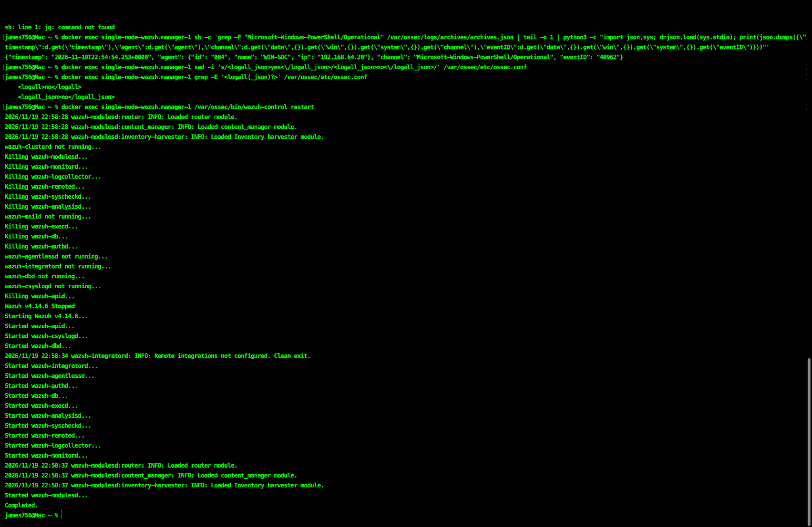
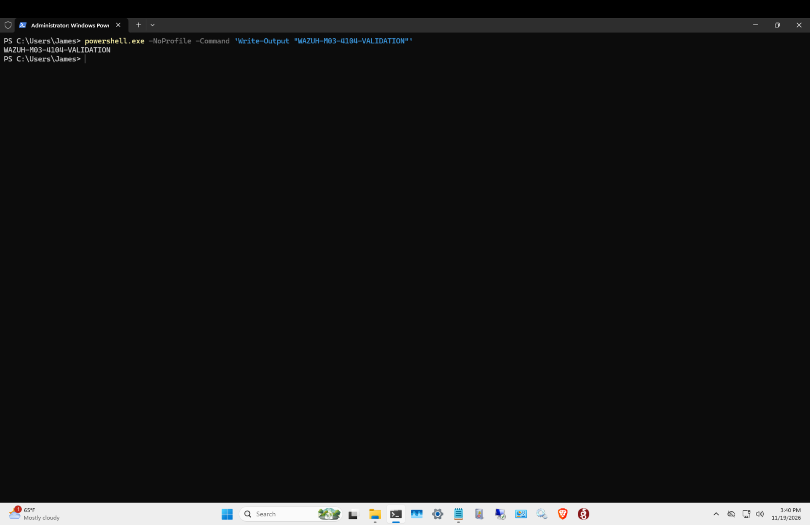
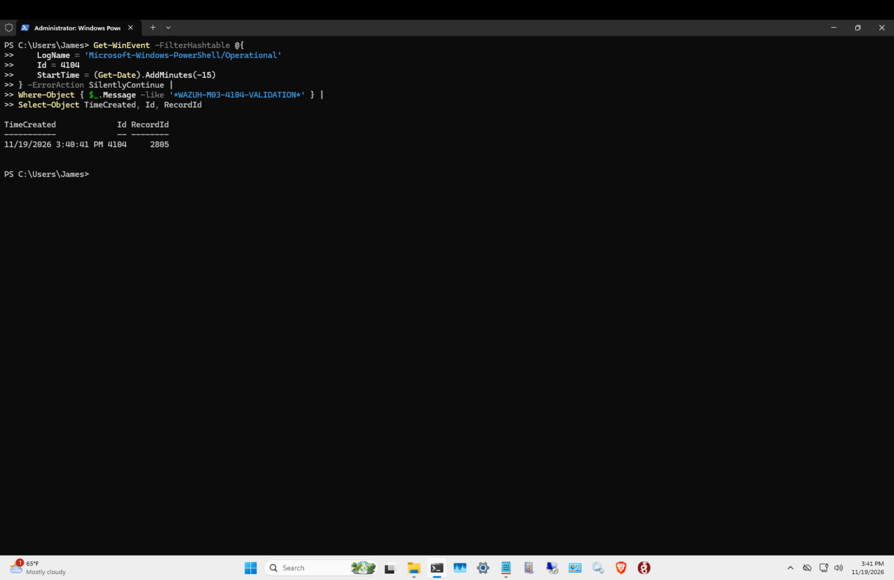
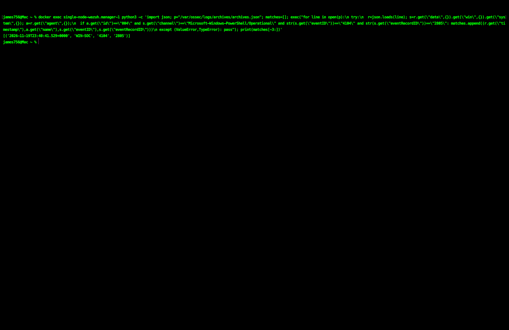
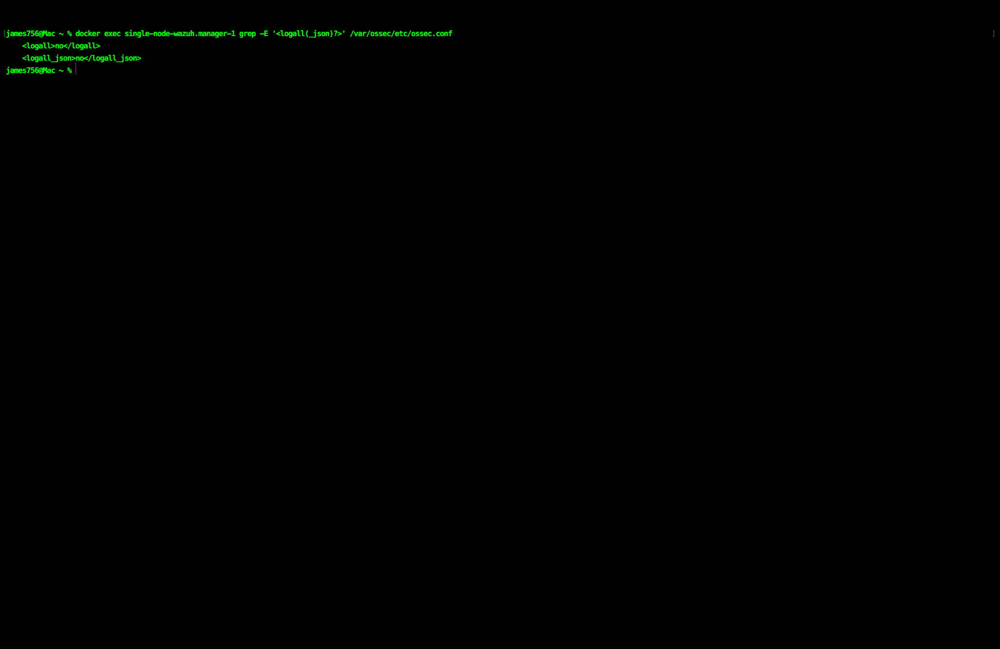
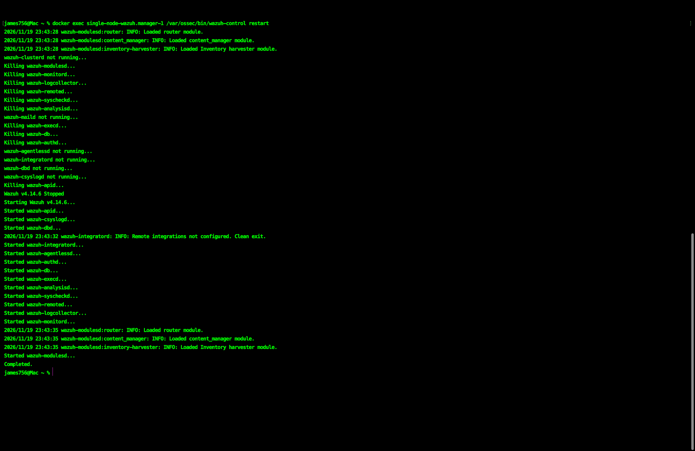

# Module 03: Windows Log Collection and Troubleshooting

**Project:** [Wazuh Operations Lab](../README.md)  
**Environment:** Wazuh 4.14.6 | Docker | Windows 11  
**Status:** Completed  
**Assessment:** Demonstrated within the tested scope  
**Validation Date:** November 19, 2026

## 1. Objective

Investigate and correct a missing Windows event channel collector on WIN-SOC, then verify that PowerShell Operational events reach the Wazuh Manager.

The exercise focused on six operational checks:

1. Inspect the existing Windows event collection configuration.
2. Identify the missing PowerShell Operational collector.
3. Apply and validate the required configuration.
4. Confirm PowerShell Operational event reception.
5. Independently validate PowerShell Script Block Logging Event ID 4104.
6. Restore temporary diagnostic settings after verification.

The objective was to verify actual telemetry reception rather than relying only on agent connectivity or successful configuration commands.

## 2. Lab Environment

| Component | Configuration |
|---|---|
| Host | MacBook Air M2 |
| Operating System | macOS |
| Container Platform | Docker |
| Wazuh Deployment | Single node |
| Wazuh Version | 4.14.6 |
| Wazuh Components | Manager, Indexer, Dashboard |
| Endpoint | Windows 11 ARM64 |
| Hostname | WIN-SOC |
| Endpoint IP | 192.168.64.20 |
| Wazuh Agent | 4.14.9 |
| Agent ID | 004 |
| Agent Service | WazuhSvc |
| Event Channel | Microsoft-Windows-PowerShell/Operational |

### Collection Architecture

```text
Windows 11: WIN-SOC
│
├── Windows PowerShell Operational Log
│   ├── Event ID 40962
│   └── Event ID 4104
│
└── Wazuh Agent 004
    │
    │ Event collection
    ▼
Wazuh Manager 4.14.6
│
├── Event decoding and rule processing
└── Temporary JSON archive validation
    │
    └── archives.json
```

The Windows agent collects events from configured sources and forwards them to the Wazuh Manager.

Manager raw event archiving was enabled temporarily to validate reception of events that were not necessarily generating alerts.

## 3. Log Collection Troubleshooting

### Check 01: Existing Collector Configuration

**Objective:** Determine whether the Windows agent was configured to collect PowerShell Operational events.

**Action:**

Inspected the Windows agent configuration:

```text
C:\Program Files (x86)\ossec-agent\ossec.conf
```

Also inspected the local Windows PowerShell Operational channel.

**Observed:**

1. The PowerShell Operational channel was enabled.
2. The channel contained existing Windows events.
3. The agent configuration did not contain an explicit collector for this channel.

**Interpretation:** The missing collector entry represented a configuration gap in the intended telemetry collection setup.

**Limitation:** The missing entry alone did not establish that every PowerShell event was unavailable through all possible collection mechanisms.

### Check 02: Collector Configuration Remediation

**Objective:** Configure WIN-SOC to collect PowerShell Operational events.

**Action:**

Added the following configuration to the Windows agent's `ossec.conf`:

```xml
<localfile>
  <location>Microsoft-Windows-PowerShell/Operational</location>
  <log_format>eventchannel</log_format>
</localfile>
```

The existing Windows Security, System, Application, Sysmon, and other collection settings were preserved.

The updated XML configuration was validated, and the Windows Wazuh agent service was restarted.

**Observed:**

The agent log reported:

```text
INFO: (1951): Analyzing event log: 'Microsoft-Windows-PowerShell/Operational'
```

**Interpretation:** The Wazuh agent initialized collection from the PowerShell Operational channel.

**Limitation:** Collector initialization does not independently establish successful event delivery to the Manager.

### Check 03: Initial PowerShell Event Reception

**Objective:** Verify that a PowerShell Operational event reached the Wazuh Manager.

**Action:**

Temporarily enabled JSON raw event archiving in the Wazuh Manager configuration.

```xml
<logall>no</logall>
<logall_json>yes</logall_json>
```

The Manager was restarted to apply the diagnostic configuration.

Inspected the received records in:

```text
/var/ossec/logs/archives/archives.json
```

**Observed:**

A received PowerShell Operational record contained the following metadata:

| Field | Value |
|---|---|
| Agent | WIN-SOC |
| Agent ID | 004 |
| Agent IP | 192.168.64.20 |
| Event Channel | Microsoft-Windows-PowerShell/Operational |
| Event ID | 40962 |
| Archive Timestamp | 2026-11-19T22:54:54.253+0000 |

**Evidence M03-E01: PowerShell Operational Event Reception**



**Observation:** The Wazuh Manager archive contained a PowerShell Operational record from WIN-SOC.

**Interpretation:** End to end reception of the inspected PowerShell Operational event was demonstrated.

**Limitation:** This result established reception of Event ID 40962. It did not independently establish reception of Event ID 4104.

### Check 04: PowerShell Script Block Logging Configuration

**Objective:** Generate a controlled Event ID 4104 for independent collection validation.

**Action:**

Reviewed the Windows Script Block Logging policy.

An explicit enabled policy value was not initially returned by the registry query.

The policy was then configured on WIN-SOC:

```powershell
New-Item -Path 'HKLM:\SOFTWARE\Policies\Microsoft\Windows\PowerShell\ScriptBlockLogging' -Force | Out-Null

New-ItemProperty -Path 'HKLM:\SOFTWARE\Policies\Microsoft\Windows\PowerShell\ScriptBlockLogging' -Name EnableScriptBlockLogging -Value 1 -PropertyType DWord -Force
```

**Observed:**

```text
EnableScriptBlockLogging : 1
```

**Interpretation:** Windows PowerShell Script Block Logging was explicitly enabled for the controlled test.

**Limitation:** Script Block Logging records executed script content and can capture sensitive information. Only harmless test activity was used during validation.

### Check 05: Controlled Event ID 4104 Generation

**Objective:** Confirm that Windows generated a Script Block Logging event containing a unique test marker.

**Action:**

Launched a new Windows PowerShell process:

```powershell
powershell.exe -NoProfile -Command 'Write-Output "WAZUH-M03-4104-VALIDATION"'
```

**Observed output:**

```text
WAZUH-M03-4104-VALIDATION
```

Queried the local PowerShell Operational channel for Event ID 4104 containing the marker.

**Observed:**

| Field | Value |
|---|---|
| Event Channel | Microsoft-Windows-PowerShell/Operational |
| Event ID | 4104 |
| Event Record ID | 2805 |
| Windows Event Time | November 19, 2026, 3:40:41 PM |
| Test Marker | WAZUH-M03-4104-VALIDATION |

**Evidence M03-E02: Controlled PowerShell Test**



**Evidence M03-E03: Local Event ID 4104**



**Observation:** Windows generated Event ID 4104, Record ID 2805, containing the controlled validation marker.

**Interpretation:** Script Block Logging successfully recorded the controlled PowerShell execution.

**Limitation:** Local Windows event generation does not independently prove that the event reached Wazuh.

### Check 06: Wazuh Manager Event ID 4104 Ingestion

**Objective:** Confirm that the exact Windows Event ID 4104 record reached the Wazuh Manager.

**Action:**

Queried the Manager's temporary JSON archive using the following matching fields:

1. Agent ID 004
2. PowerShell Operational channel
3. Event ID 4104
4. Event Record ID 2805

**Observed result:**

```text
[('2026-11-19T23:40:41.529+0000', 'WIN-SOC', '4104', '2805')]
```

**Evidence M03-E04: Wazuh Manager Ingestion**



**Observation:** The Manager archive contained Event ID 4104, Record ID 2805, from WIN-SOC.

The Event ID and Record ID matched the controlled event observed locally.

**Interpretation:** End to end ingestion of the specific Windows PowerShell Script Block Logging event was demonstrated.

**Limitation:** Event reception does not automatically establish that a Wazuh detection rule generated an alert.

No Event ID 4104 alert was demonstrated during this exercise.

### Check 07: Temporary Diagnostic Configuration Cleanup

**Objective:** Restore normal Manager raw event archiving settings after completing validation.

**Action:**

Restored the Manager configuration to:

```xml
<logall>no</logall>
<logall_json>no</logall_json>
```

Verified the saved values and restarted Wazuh Manager 4.14.6.

**Observed:**

1. Both Manager archiving settings reported `no`.
2. The Wazuh Manager restart completed successfully.
3. The restart output ended with `Completed.`.

**Evidence M03-E05: Manager Archiving Configuration**



**Evidence M03-E06: Manager Restart**



**Observation:** The Manager configuration was restored, and the restart completed successfully.

**Interpretation:** Temporary JSON raw event archiving was disabled after validation.

**Operational Note:** The previously archived records were not separately verified as deleted.

PowerShell Script Block Logging remains enabled on WIN-SOC as an intentional laboratory telemetry configuration.

## 4. Evidence Index

| Evidence ID | Screenshot | Verified Finding |
|---|---|---|
| M03-E01 | [PowerShell Operational Ingestion](evidence/m03-01-powershell-operational-ingestion.png) | Event ID 40962 received by Manager |
| M03-E02 | [Controlled PowerShell Test](evidence/m03-02-powershell-test-command.png) | Validation command executed |
| M03-E03 | [Local Event ID 4104](evidence/m03-03-windows-event-4104.png) | Event ID 4104, Record ID 2805 generated |
| M03-E04 | [Manager Event Ingestion](evidence/m03-04-wazuh-manager-4104-ingestion.png) | Matching Event ID 4104 received |
| M03-E05 | [Archiving Configuration](evidence/m03-05-archive-settings-restored.png) | Raw event archiving restored to disabled |
| M03-E06 | [Manager Restart](evidence/m03-06-manager-restart-completed.png) | Manager restart completed |

### Evidence Integrity

All screenshots originate from actual laboratory observations.

Local event generation, agent collector initialization, Manager event reception, and detection rule alerting are treated as separate validation checkpoints.

The evidence supports collection of the tested PowerShell Operational events.

No unsupported claim of complete PowerShell telemetry coverage or Event ID 4104 alert generation is made.

### Evidence Directory

```text
module-03-log-ingestion/
├── README.md
├── investigation_notes.md
└── evidence/
    ├── m03-01-powershell-operational-ingestion.png
    ├── m03-02-powershell-test-command.png
    ├── m03-03-windows-event-4104.png
    ├── m03-04-wazuh-manager-4104-ingestion.png
    ├── m03-05-archive-settings-restored.png
    └── m03-06-manager-restart-completed.png
```

## 5. Findings

### Finding 01: Missing Event Collector

The Windows agent configuration lacked an explicit PowerShell Operational event collector.

The required configuration was added and initialized successfully.

### Finding 02: PowerShell Operational Event Reception

The Wazuh Manager received Event ID 40962 from WIN-SOC.

This demonstrated reception from the configured PowerShell Operational channel.

### Finding 03: Script Block Logging Validation

Script Block Logging was explicitly enabled on WIN-SOC.

The controlled test generated Event ID 4104 with Record ID 2805.

### Finding 04: Event ID 4104 Ingestion

The Wazuh Manager received the same Event ID 4104 and Record ID 2805.

This independently demonstrated collection of the controlled Script Block Logging event.

### Finding 05: Diagnostic Configuration Restoration

Manager raw event archiving was restored to its original disabled configuration.

The Manager restarted successfully after the change.

## 6. Operational Lessons

### Agent Connectivity Does Not Guarantee Event Collection

An Active agent may still lack an intended event channel collector.

Collector configuration and actual event reception require separate validation.

### Collector Initialization Does Not Prove Ingestion

The agent log confirmed initialization of the PowerShell Operational channel.

Manager archive inspection was necessary to establish that an event had actually arrived.

### Local Event Generation and Manager Reception Are Separate

Windows Event ID 4104 was first verified locally.

The matching Event ID and Record ID were then confirmed independently in the Manager archive.

### Event Ingestion Does Not Guarantee Alert Generation

A collected event may not satisfy the conditions required for a Wazuh alert.

Event ID 4104 ingestion was demonstrated, but alert generation was not established.

### Temporary Diagnostic Changes Require Cleanup

JSON raw event archiving was used temporarily for troubleshooting.

The original disabled setting was restored and the Manager restarted after validation.

### Evidence Determines the Conclusion

**Observed:** PowerShell Operational Event IDs 40962 and 4104 reached the Wazuh Manager.

**Interpretation:** The corrected collection configuration successfully supported ingestion of the tested PowerShell Operational events.

**Unknown:** Complete PowerShell event coverage and Event ID 4104 detection rule alert generation.

## 7. Outcome and Assessment

**Practical Result:** Completed

**Assessment:** Demonstrated within the tested scope

### Competencies Demonstrated

1. Windows agent configuration inspection
2. Windows event channel collection troubleshooting
3. Wazuh localfile eventchannel configuration
4. Agent collector initialization verification
5. PowerShell Script Block Logging configuration
6. Controlled Windows event generation
7. Manager raw event ingestion verification
8. Event correlation using agent identity and record metadata
9. Temporary diagnostic configuration restoration
10. Evidence based operational documentation

### Limitations

The exercise did not establish:

1. Complete collection of every PowerShell event
2. Wazuh alert generation for Event ID 4104
3. Production scale event ingestion performance
4. Long term ingestion reliability
5. Guaranteed event delivery under all failure conditions
6. Deletion of previously written raw archive records

### Final Assessment

Module 03 identified and corrected a missing PowerShell Operational event collection configuration.

The evidence confirmed that WIN-SOC successfully forwarded the tested PowerShell Operational events to the Wazuh Manager.

Event ID 40962 was observed in the Manager archive.

Event ID 4104, Record ID 2805, was generated locally and subsequently matched to the Manager archive using event metadata.

Temporary raw event archiving was disabled after validation, and the Manager restarted successfully.

These observations demonstrate successful end to end collection of the tested PowerShell Operational telemetry.

**Module 03 Status: Completed**

## 8. Repository Navigation

[Previous Module: Windows Agent Troubleshooting](../module-02-agent-troubleshooting/README.md) | [Project Home](../README.md) | [Continue to Module 04](../module-04-file-integrity-monitoring/README.md)
