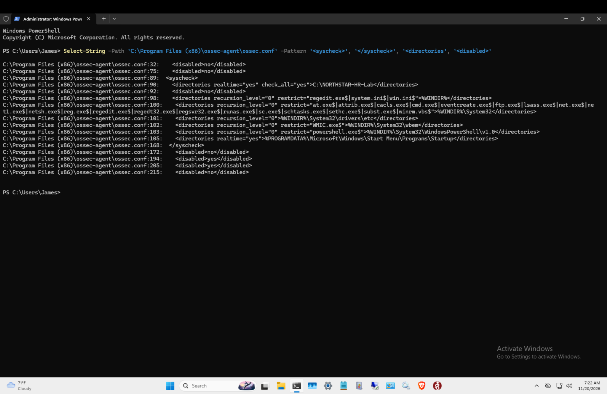
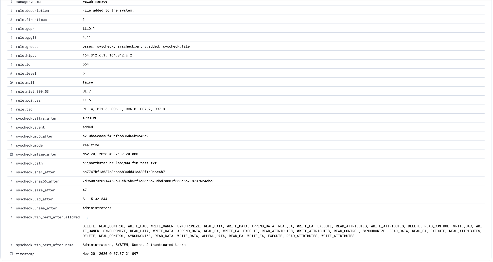
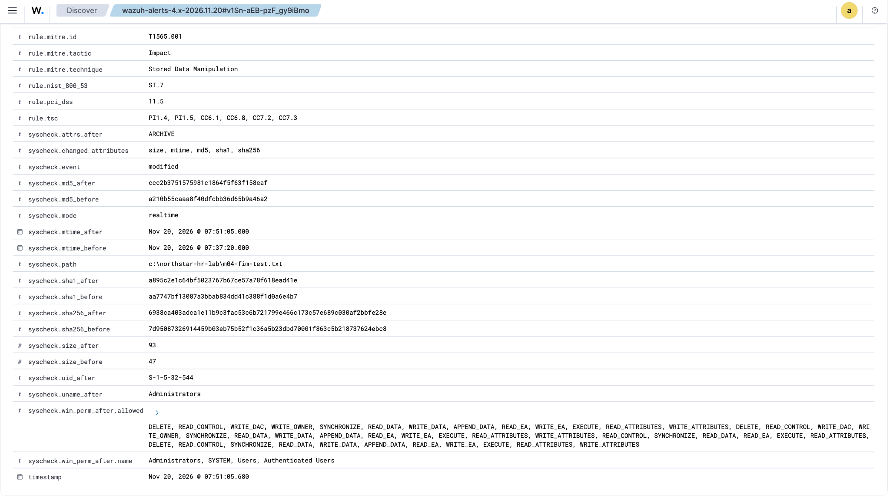
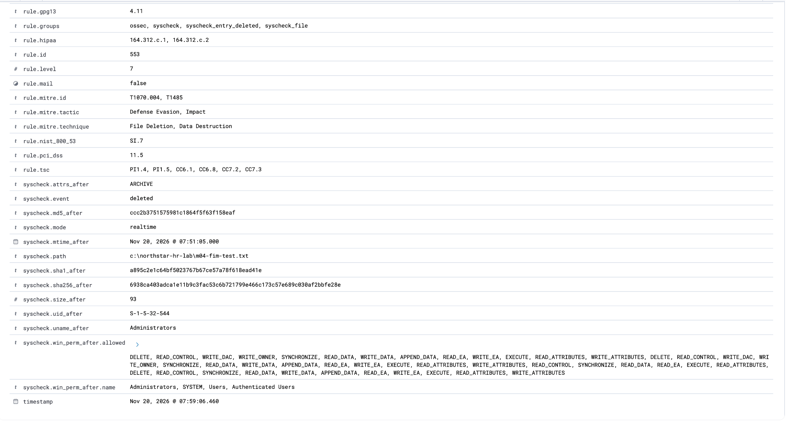
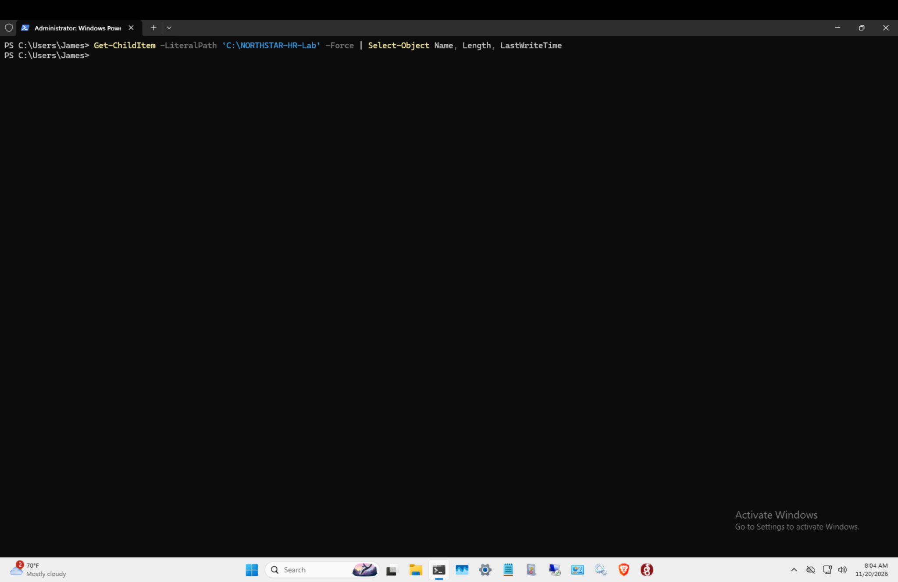

# Module 04: File Integrity Monitoring

**Project:** [Wazuh Operations Lab](../README.md)  
**Environment:** Wazuh 4.14.6 | Docker | Windows 11  
**Status:** Completed  
**Assessment:** Demonstrated within the tested scope  
**Validation Date:** November 20, 2026

## 1. Objective

Validate File Integrity Monitoring on WIN-SOC by performing controlled file operations and independently confirming the resulting Wazuh alerts.

The exercise focused on six operational checks:

1. Verify the existing FIM configuration.
2. Establish the monitored directory baseline.
3. Create a controlled file and verify detection.
4. Modify the file and investigate integrity changes.
5. Delete the file and verify detection.
6. Confirm the final directory state.

The objective was to demonstrate actual file change detection, event correlation, and evidence based analyst assessment.

## 2. Lab Environment

| Component | Configuration |
|---|---|
| Host | MacBook Air M2 |
| Operating System | macOS |
| Container Platform | Docker |
| Wazuh Deployment | Single node |
| Wazuh Version | 4.14.6 |
| Wazuh Components | Manager, Indexer, Dashboard |
| Endpoint | Windows 11 ARM64 |
| Hostname | WIN-SOC |
| Endpoint IP | 192.168.64.20 |
| Wazuh Agent | 4.14.9 |
| Agent ID | 004 |
| Monitoring Component | File Integrity Monitoring |
| Monitored Directory | C:\NORTHSTAR-HR-Lab |
| Monitoring Mode | Realtime |

### Monitoring Architecture

```text
Windows 11 ARM64
│
└── WIN-SOC
    │
    ├── C:\NORTHSTAR-HR-Lab
    │   └── M04-FIM-TEST.txt
    │
    └── Wazuh Agent 004
        │
        │ File Integrity Monitoring
        ▼
Wazuh Manager 4.14.6
│
├── Event decoding
├── Rule processing
│
├── Rule 554: File added
├── Rule 550: Integrity changed
└── Rule 553: File deleted
        │
        ▼
Wazuh Dashboard
│
└── Threat Hunting
```

The Wazuh agent monitors the configured directory and forwards detected file integrity changes to the Manager.

The Manager processes the events using Wazuh rules, making the resulting alerts available for investigation.

**Scope:** One monitored Windows endpoint and one controlled test file.

## 3. File Integrity Monitoring Validation

### Check 01: Existing FIM Configuration

**Objective:** Confirm that File Integrity Monitoring was configured for the intended Windows directory.

**Action:** Inspected the Windows agent configuration using PowerShell.

```powershell
Select-String -Path 'C:\Program Files (x86)\ossec-agent\ossec.conf' -Pattern '<syscheck>', '</syscheck>', '<directories', '<disabled>'
```

**Observed Results:**

The configuration contained an enabled syscheck section and the following monitored directory entry:

```xml
<directories realtime="yes" check_all="yes">C:\NORTHSTAR-HR-Lab</directories>
```

The syscheck section also contained:

```xml
<disabled>no</disabled>
```

**Evidence M04-E01: FIM Configuration**



**Observation:** The Windows agent configuration specified real time monitoring for `C:\NORTHSTAR-HR-Lab`.

**Interpretation:** The intended directory was configured for File Integrity Monitoring.

**Limitation:** A valid configuration entry does not independently prove that file changes are currently being detected.

### Check 02: Directory Baseline

**Objective:** Establish the initial state of the monitored directory before introducing test activity.

**Action:** Verified the monitored directory existed.

```powershell
Get-Item 'C:\NORTHSTAR-HR-Lab' | Select-Object FullName, Exists, LastWriteTime
```

**Observed:**

```text
FullName               Exists
--------               ------
C:\NORTHSTAR-HR-Lab    True
```

Inspected the directory contents:

```powershell
Get-ChildItem 'C:\NORTHSTAR-HR-Lab' -Force | Select-Object Name, Length, LastWriteTime
```

**Observed:** No files or folders were returned.

**Interpretation:** The directory existed and was empty at the beginning of the controlled exercise.

This established the baseline against which subsequent file operations could be compared.

### Check 03: Controlled File Creation

**Objective:** Generate a file creation event and verify that Wazuh detected the specific file.

**Action:** Created a harmless text file inside the monitored directory.

```powershell
Set-Content -Path 'C:\NORTHSTAR-HR-Lab\M04-FIM-TEST.txt' -Value 'Wazuh Module 04 controlled file creation test'; Get-Item 'C:\NORTHSTAR-HR-Lab\M04-FIM-TEST.txt' | Select-Object Name, Length, LastWriteTime
```

**Observed Windows Results:**

| Field | Value |
|---|---|
| Filename | M04-FIM-TEST.txt |
| File Size | 47 bytes |
| Last Modified | November 20, 2026, 7:37:20 AM |
| Directory | C:\NORTHSTAR-HR-Lab |

The file was successfully created.

**Wazuh Verification:**

Opened Threat Hunting and searched for file creation alerts associated with WIN-SOC.

```text
agent.id:"004" and rule.id:"554"
```

The search returned one matching alert.

The alert details identified the exact test file.

**Observed Wazuh Results:**

| Field | Value |
|---|---|
| Agent | WIN-SOC |
| Agent ID | 004 |
| File Path | c:\northstar-hr-lab\m04-fim-test.txt |
| FIM Event | added |
| Monitoring Mode | realtime |
| Rule ID | 554 |
| Rule Description | File added to the system. |
| Rule Level | 5 |
| File Size | 47 bytes |
| Alert Time | November 20, 2026, 7:37:21 AM |

**Evidence M04-E02: File Creation Detection**



**Observation:** Wazuh generated Rule 554 for the exact file created during the controlled test.

The event identified the monitored file path, event type, file size, and real time monitoring mode.

**Interpretation:** Real time FIM detection and alert generation were demonstrated for the controlled file creation.

**Limitation:** The reported file owner does not independently establish which user account performed the operation.

### Check 04: Controlled File Modification

**Objective:** Verify that Wazuh detected changes to an existing monitored file.

**Action:** Appended a second line to the test file.

```powershell
Add-Content -Path 'C:\NORTHSTAR-HR-Lab\M04-FIM-TEST.txt' -Value 'Wazuh Module 04 controlled modification test'; Get-Item 'C:\NORTHSTAR-HR-Lab\M04-FIM-TEST.txt' | Select-Object Name, Length, LastWriteTime
```

**Observed Windows Results:**

| Field | Before | After |
|---|---|---|
| Filename | M04-FIM-TEST.txt | M04-FIM-TEST.txt |
| Size | 47 bytes | 93 bytes |
| Last Modified | 7:37:20 AM | 7:51:05 AM |

The existing file remained present, and its size increased by 46 bytes.

**Wazuh Verification:**

Searched Threat Hunting for integrity change alerts.

```text
agent.id:"004" and rule.id:"550"
```

The search returned one matching alert.

The event details confirmed the exact file path and changes to recorded integrity attributes.

**Observed Wazuh Results:**

| Field | Value |
|---|---|
| Agent | WIN-SOC |
| Agent ID | 004 |
| File Path | c:\northstar-hr-lab\m04-fim-test.txt |
| FIM Event | modified |
| Monitoring Mode | realtime |
| Rule ID | 550 |
| Rule Description | Integrity checksum changed. |
| Rule Level | 7 |
| Size Before | 47 bytes |
| Size After | 93 bytes |
| Changed Attributes | size, mtime, md5, sha1, sha256 |
| Alert Time | November 20, 2026, 7:51:05 AM |

**Evidence M04-E03: File Integrity Modification**



**Observation:** Wazuh detected changes to the test file's size, modification timestamp, and cryptographic hashes.

The recorded file size increased from 47 to 93 bytes, matching the controlled PowerShell activity.

**Interpretation:** File integrity modification detection was demonstrated.

The changed MD5, SHA1, and SHA256 values support that the monitored file contents changed.

**Limitation:** FIM establishes that monitored file attributes changed. It does not automatically identify the process, account, or physical person responsible.

### Check 05: Controlled File Deletion

**Objective:** Confirm that Wazuh detected removal of the monitored test file.

**Action:** Deleted the controlled test file and checked whether it still existed.

```powershell
Remove-Item -LiteralPath 'C:\NORTHSTAR-HR-Lab\M04-FIM-TEST.txt'; Test-Path -LiteralPath 'C:\NORTHSTAR-HR-Lab\M04-FIM-TEST.txt'
```

**Observed Windows Result:**

```text
False
```

The result confirmed that the file no longer existed at the specified path.

**Wazuh Verification:**

Searched Threat Hunting for file deletion alerts.

```text
agent.id:"004" and rule.id:"553"
```

The search returned one matching alert.

The expanded event identified the exact monitored file.

**Observed Wazuh Results:**

| Field | Value |
|---|---|
| Agent | WIN-SOC |
| Agent ID | 004 |
| File Path | c:\northstar-hr-lab\m04-fim-test.txt |
| FIM Event | deleted |
| Monitoring Mode | realtime |
| Decoder | syscheck_deleted |
| Rule ID | 553 |
| Rule Description | File deleted. |
| Rule Level | 7 |
| Last Recorded File Size | 93 bytes |
| Alert Time | November 20, 2026, 7:59:06 AM |

**Evidence M04-E04: File Deletion Detection**



**Observation:** Wazuh generated Rule 553 for the exact test file that had been deleted.

The event contained the file path, deletion event type, monitoring mode, and previously recorded file metadata.

**Interpretation:** Real time FIM deletion detection was demonstrated for the controlled file.

**Limitation:** The event retained the file owner value `Administrators`.

This identifies recorded ownership information, not the account or person responsible for deleting the file.

Attribution would require additional correlated Windows file access or process evidence.

### Check 06: Final Directory Verification

**Objective:** Confirm that the controlled exercise left the monitored directory in its original state.

**Action:** Inspected the directory contents after deleting the test file.

```powershell
Get-ChildItem -LiteralPath 'C:\NORTHSTAR-HR-Lab' -Force | Select-Object Name, Length, LastWriteTime
```

**Observed:** The command returned no files or folders.

**Evidence M04-E05: Final Directory State**



**Observation:** The monitored directory was empty after completing the controlled file operations.

**Interpretation:** The test file was removed, and the directory returned to its original empty baseline.

**Limitation:** This check confirms the directory contents at the time of inspection. It does not establish the absence of all historical file activity.

## 4. Evidence Index

| Evidence ID | Screenshot | Verified Finding |
|---|---|---|
| M04-E01 | [FIM Configuration](evidence/m04-01-fim-configuration.png) | Real time monitoring configured |
| M04-E02 | [File Creation](evidence/m04-02-file-creation-detected.png) | Rule 554 detected the added file |
| M04-E03 | [File Modification](evidence/m04-03-file-modification-detected.png) | Rule 550 detected integrity changes |
| M04-E04 | [File Deletion](evidence/m04-04-file-deletion-detected.png) | Rule 553 detected the deleted file |
| M04-E05 | [Final Directory State](evidence/m04-05-final-directory-baseline.png) | Directory returned to empty baseline |

### Evidence Integrity

All screenshots originate from actual laboratory observations performed on November 20, 2026.

The selected screenshots support distinct validation checkpoints.

File creation, modification, and deletion were confirmed through local Windows activity and corresponding Wazuh events.

No unsupported claims of malicious activity, user attribution, or complete endpoint monitoring coverage are made.

### Evidence Directory

```text
module-04-file-integrity-monitoring/
├── README.md
├── investigation_notes.md
└── evidence/
    ├── m04-01-fim-configuration.png
    ├── m04-02-file-creation-detected.png
    ├── m04-03-file-modification-detected.png
    ├── m04-04-file-deletion-detected.png
    └── m04-05-final-directory-baseline.png
```

## 5. Findings

### Finding 01: Existing FIM Configuration

The Wazuh Windows agent was configured to monitor `C:\NORTHSTAR-HR-Lab` in real time.

No additional FIM configuration was required for the tested directory.

### Finding 02: File Creation Detection

The controlled creation of `M04-FIM-TEST.txt` generated Wazuh Rule 554.

The alert identified the exact file path and recorded the file size as 47 bytes.

### Finding 03: File Modification Detection

The controlled modification generated Wazuh Rule 550.

The event recorded the file size increase from 47 to 93 bytes and changes to integrity hashes.

### Finding 04: File Deletion Detection

The controlled deletion generated Wazuh Rule 553.

The event confirmed the exact file path and deletion event type.

### Finding 05: Attribution Limitation

FIM recorded file ownership metadata but did not establish the identity of the account responsible for each operation.

The `Administrators` owner field was not treated as proof of the acting user.

### Finding 06: Final Directory State

The monitored directory returned to its initial empty baseline.

No test files remained at the conclusion of the exercise.

## 6. Operational Lessons

### Configuration Does Not Prove Detection

The FIM configuration showed that real time monitoring was enabled.

Actual detection was established only after the controlled file operations generated corresponding Wazuh alerts.

### File Changes Require Event Correlation

Each local Windows operation was compared with the corresponding Wazuh event using the filename, event type, and timestamps.

This helped distinguish the controlled activity from unrelated file changes.

### Cryptographic Hashes Strengthen Integrity Analysis

The modification event recorded changes in MD5, SHA1, and SHA256 values.

Together with the file size and modification timestamp, these fields supported the conclusion that file content had changed.

### File Ownership Is Not User Attribution

The recorded owner was `Administrators`.

This does not prove which account or person performed the file creation, modification, or deletion.

Further attribution requires relevant Windows access auditing or process telemetry.

### Detection Does Not Automatically Establish Malicious Activity

The three alerts were generated by authorized laboratory actions.

The FIM events were valid detections, but the underlying activity was expected and controlled.

### Evidence Determines the Conclusion

**Observed:** Wazuh generated Rules 554, 550, and 553 for the exact controlled test file.

**Interpretation:** Real time FIM detection worked for the tested creation, modification, and deletion operations.

**Unknown:** Whether the same results would occur under every possible file operation, monitoring failure, or production condition.

## 7. Outcome and Assessment

**Practical Result:** Completed

**Assessment:** Demonstrated within the tested scope

### Competencies Demonstrated

1. Windows FIM configuration inspection
2. Monitored directory baseline verification
3. Controlled file creation testing
4. File modification and integrity analysis
5. File deletion detection validation
6. Wazuh Rule 554 investigation
7. Wazuh Rule 550 investigation
8. Wazuh Rule 553 investigation
9. File size and cryptographic hash comparison
10. Evidence based analyst interpretation
11. File ownership and attribution distinction
12. Final directory state verification

### Limitations

The exercise did not establish:

1. Identity of the account responsible for the file operations from FIM evidence alone
2. Complete detection coverage for every possible file operation
3. Continuous monitoring availability under failure conditions
4. Production scale FIM performance
5. Comprehensive process attribution
6. Malicious intent associated with the controlled file activity

### Final Assessment

Module 04 successfully demonstrated real time File Integrity Monitoring on WIN-SOC.

The existing FIM configuration monitored `C:\NORTHSTAR-HR-Lab`.

Controlled file creation, modification, and deletion generated Wazuh Rules 554, 550, and 553 respectively.

The recorded event paths matched the controlled test file.

The modification event also confirmed changes to file size, timestamps, and cryptographic hashes.

The final directory inspection confirmed that the controlled test file had been removed.

The activity was authorized laboratory testing. No malicious activity or responsible user identity was independently established from FIM evidence.

**Module 04 Status: Completed**

## 8. Repository Navigation

[Previous Module: Windows Log Collection and Troubleshooting](../module-03-log-ingestion/README.md) | [Project Home](../README.md) | [Continue to Module 05](../module-05-soc-investigations/README.md)
