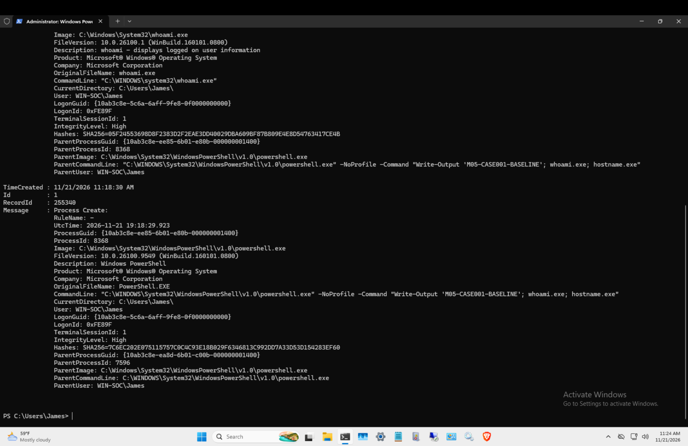
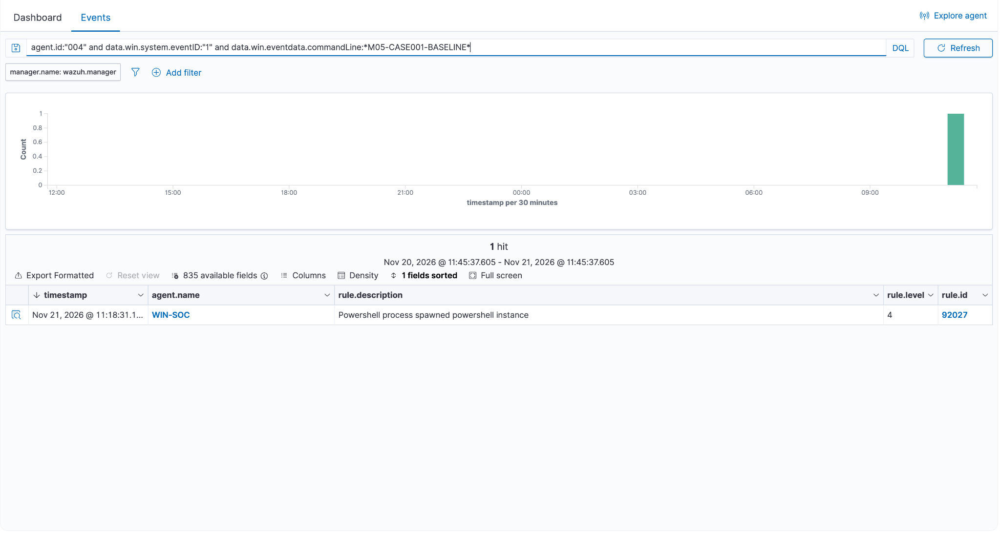
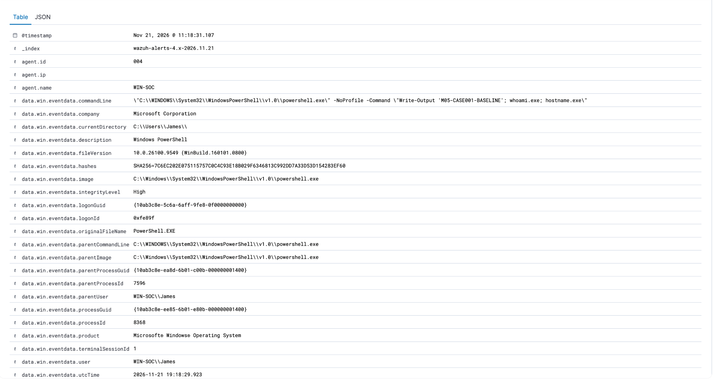
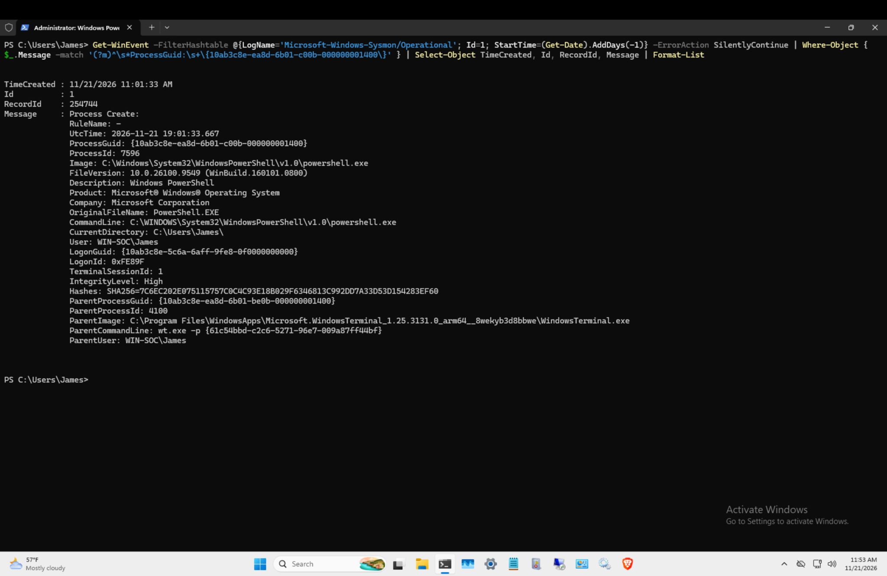
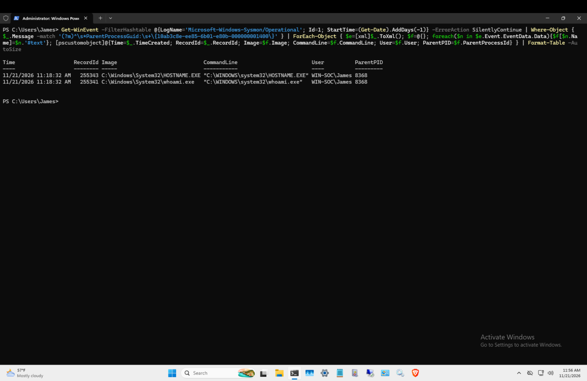

# Module 05: Joint SOC × DFIR Investigations

**Project:** [Wazuh Operations Lab](../README.md)  
**Module:** Joint SOC × DFIR Investigations  
**Environment:** Wazuh 4.14.6 | Docker | Windows 11 ARM64 | WIN-SOC  
**Date:** November 21, 2026  
**Case ID:** M05-001  
**Case Title:** PowerShell Process Execution Investigation  
**Case Status:** Completed  
**Assessment:** Demonstrated within the tested scope  
**Disposition:** Benign True Positive — Authorized Lab Activity

## 1. Objective

Investigate a PowerShell process execution alert using Windows Sysmon and Wazuh telemetry.

The exercise focused on:

1. Establishing a known activity baseline.
2. Identifying Sysmon process creation events.
3. Investigating PowerShell command-line activity.
4. Reconstructing parent-child process relationships.
5. Correlating endpoint telemetry with Wazuh detections.
6. Assessing the activity using verified evidence.
7. Determining an appropriate incident disposition.
8. Documenting the investigation for analyst handoff.

The investigation was performed in a controlled home-lab environment.

## 2. Investigation Scenario

A controlled PowerShell command was intentionally executed on WIN-SOC to produce observable process creation activity.

```powershell
powershell.exe -NoProfile -Command "Write-Output 'M05-CASE001-BASELINE'; whoami.exe; hostname.exe"
```

The command performed three actions:

| Command | Purpose |
|---|---|
| `Write-Output` | Generated a unique investigation marker |
| `whoami.exe` | Displayed the executing account |
| `hostname.exe` | Displayed the endpoint hostname |

The marker `M05-CASE001-BASELINE` was used to locate the corresponding process creation events.

Although `whoami.exe` and `hostname.exe` are legitimate Windows utilities, they can also appear during attacker reconnaissance.

The investigation therefore focused on execution context rather than assuming malicious intent based on process names.

## 3. Lab Environment

| Component | Configuration |
|---|---|
| Wazuh deployment | Single-node Docker |
| Wazuh version | 4.14.6 |
| Endpoint | WIN-SOC |
| Operating system | Windows 11 ARM64 |
| Wazuh agent ID | 004 |
| Endpoint telemetry | Windows Sysmon |
| Primary event | Sysmon Event ID 1 |
| Investigation interface | Wazuh Threat Hunting |

## 4. Investigation Workflow

### Step 01: Establish the Baseline

The controlled PowerShell command was executed successfully on WIN-SOC.

The output confirmed the expected executing account and hostname.

The test activity was known and authorized before the investigation began.

This baseline provided a reference against which the collected telemetry could be compared.

### Step 02: Investigate Sysmon Process Creation

Sysmon Event ID 1 was queried to identify the PowerShell process associated with the investigation marker.

The following record was confirmed:

| Field | Verified value |
|---|---|
| Event ID | 1 |
| Record ID | 255340 |
| Process | `powershell.exe` |
| Process ID | 8368 |
| Parent Process ID | 7596 |
| User | `WIN-SOC\James` |
| Integrity Level | High |
| Investigation marker | `M05-CASE001-BASELINE` |

The command line matched the controlled laboratory activity.

Sysmon also recorded the execution of the associated Windows discovery utilities.

**Evidence: Sysmon Process Creation**



**Analyst observation:** The process creation record established which executable ran, its command line, the associated user account, and its reported parent process.

**Analyst interpretation:** The command line was consistent with the known laboratory test. The presence of PowerShell and discovery commands alone did not establish malicious behavior.

### Step 03: Validate Wazuh Detection

Wazuh Threat Hunting was searched using the known investigation marker.

The matching event was found under agent 004.

| Field | Verified value |
|---|---|
| Agent | WIN-SOC |
| Agent ID | 004 |
| Source | Sysmon Event ID 1 |
| Wazuh Rule ID | 92027 |
| Rule Level | 4 |
| Rule Description | Powershell process spawned powershell instance |
| Process ID | 8368 |

The alert contained the expected PowerShell command line and investigation marker.

**Evidence: Wazuh Alert**



**Evidence: Wazuh Event Fields**



**Analyst observation:** Wazuh processed the relevant Sysmon event and generated an alert for PowerShell spawning another PowerShell instance.

**Analyst interpretation:** The alert accurately represented the observed process execution. Its presence did not automatically establish a security incident.

### Step 04: Investigate the Parent Process

The reported parent process GUID was used to locate the original creation record for PowerShell PID 7596.

The following details were confirmed:

| Field | Verified value |
|---|---|
| Sysmon Event ID | 1 |
| Record ID | 254744 |
| Image | `powershell.exe` |
| Process ID | 7596 |
| Parent Image | `WindowsTerminal.exe` |
| Parent Process ID | 4100 |
| User | `WIN-SOC\James` |
| Integrity Level | High |

The process GUID from this record matched the parent process GUID of the investigated PowerShell process.

This relationship supported reconstruction of the process ancestry.

**Evidence: Parent Process Investigation**



**Analyst observation:** The investigated PowerShell process was launched by an earlier PowerShell session associated with Windows Terminal.

**Analyst interpretation:** The observed ancestry was consistent with execution through the interactive terminal used for the authorized laboratory test.

### Step 05: Correlate Child Processes

The investigated PowerShell process GUID was used to identify its child process creation events.

Two matching records were returned.

| Process | Process ID | Sysmon Record ID | Parent PID |
|---|---|---|---|
| `whoami.exe` | 2916 | 255341 | 8368 |
| `HOSTNAME.EXE` | 9160 | 255343 | 8368 |

Both records identified the same PowerShell process as their parent.

The executing account was `WIN-SOC\James`.

**Evidence: Child Process Correlation**



#### Reconstructed Process Ancestry

```text
WindowsTerminal.exe
    PID 4100
        |
        v
powershell.exe
    PID 7596
        |
        v
powershell.exe
    PID 8368
        |
        +-- whoami.exe
        |      PID 2916
        |
        +-- HOSTNAME.EXE
               PID 9160
```

The Windows Terminal parent relationship was reported in the original PowerShell process creation record.

**Analyst observation:** The controlled PowerShell instance launched the two expected Windows discovery utilities.

**Analyst interpretation:** The identified child processes and their command lines matched the test activity.

### Step 06: Analyst Assessment

The available evidence was reviewed using four categories.

**Observed**

PowerShell launched another PowerShell instance. That instance executed `whoami.exe` and `hostname.exe`.

**Correlated**

Sysmon Event ID 1 confirmed the process creation events and their parent-child relationships.

Wazuh Rule 92027 generated a matching alert.

The command line, investigation marker, account, and process ancestry were consistent with the authorized laboratory activity.

**Interpretation**

The detected execution was expected and authorized.

No malicious behavior was identified within the reviewed process chain.

**Unknowns**

The investigation did not establish whether unrelated suspicious activity occurred elsewhere on WIN-SOC.

No comprehensive endpoint compromise assessment was performed.

### Step 07: Incident Disposition

**Classification:** Benign True Positive  
**Authorization:** Confirmed Laboratory Test  
**Escalation:** Not Required  
**Case Status:** Closed

Wazuh correctly detected the PowerShell process execution.

The investigation established that the observed activity was part of an intentional laboratory exercise.

The detection was technically valid, while the underlying activity was benign within the investigated context.

### Step 08: Analyst Documentation and Handoff

The investigation was documented to preserve:

1. The original detection.
2. The observed command-line activity.
3. The executing account.
4. The reconstructed process ancestry.
5. The correlated Sysmon and Wazuh records.
6. The analyst assessment.
7. The evidence limitations.
8. The final disposition.

The case documentation provides a reproducible account of the investigation and its outcome.

## 5. Evidence Summary

| Evidence | Source | What it demonstrates |
|---|---|---|
| 01 | Sysmon Event ID 1 | Controlled PowerShell execution |
| 02 | Wazuh Threat Hunting | Rule 92027 detection |
| 03 | Wazuh event fields | Command-line and process metadata |
| 04 | Sysmon Event ID 1 | Parent PowerShell process and reported Windows Terminal ancestry |
| 05 | Sysmon Event ID 1 | Correlated `whoami.exe` and `HOSTNAME.EXE` child processes |

All evidence was generated from the controlled WIN-SOC laboratory investigation.

The screenshots must be saved under the filenames referenced in this README for GitHub to display them.

Private lab IP addresses must be redacted before public publication.

## 6. Key Findings

1. Sysmon Event ID 1 provided visibility into the controlled PowerShell execution.
2. Wazuh Rule 92027 detected PowerShell spawning another PowerShell instance.
3. Process GUID correlation supported reconstruction of the investigated process ancestry.
4. The identified child processes matched the controlled command.
5. The executing account and command line were consistent with the authorized test.
6. The alert represented a valid detection of benign activity.
7. No malicious behavior was identified within the reviewed execution chain.

## 7. Lessons Learned

### A Process Name Is Not a Verdict

PowerShell, `whoami.exe`, and `hostname.exe` can appear during both legitimate activity and attacker reconnaissance.

Their presence must be evaluated in context.

### Parent-Child Relationships Matter

The parent process can help explain how execution started.

Investigating process ancestry provided context beyond the original Wazuh alert.

### Process GUIDs Strengthen Correlation

Windows process IDs can be reused.

Matching Sysmon process GUIDs provided a more reliable way to connect the investigated process instances.

### Detection Does Not Equal Compromise

Wazuh accurately detected the PowerShell execution.

The analyst investigation established that the observed activity was authorized.

A technically valid detection can represent benign behavior.

### Conclusions Must Remain Evidence-Based

The investigation supported a disposition for the reviewed process chain.

It did not establish that the entire endpoint was free from threats.

## 8. Skills Demonstrated

- Windows Sysmon Event ID 1 analysis.
- Wazuh Threat Hunting.
- PowerShell command-line interpretation.
- Parent-child process analysis.
- Process GUID correlation.
- Endpoint and SIEM telemetry correlation.
- Alert triage and assessment.
- Benign true positive classification.
- Incident disposition.
- Analyst handoff documentation.

These competencies were demonstrated through controlled home-lab activity.

They do not represent professional production SOC experience.

## 9. Final Assessment

**Case:** M05-001  
**Investigation:** PowerShell Process Execution  
**Result:** Expected Authorized Activity  
**Disposition:** Benign True Positive  
**Escalation:** Not Required  
**Status:** Closed  
**Assessment:** Demonstrated within the tested scope

The case demonstrated the ability to investigate a PowerShell process execution alert by correlating Sysmon and Wazuh telemetry, reconstructing the process ancestry, and documenting an evidence-based disposition.

The investigation did not simulate a confirmed malicious intrusion.

## 10. Navigation

[Project Home](../README.md) | [Previous Module](../module-04-file-integrity-monitoring/README.md) | [Continue to Module 06](../module-06-customer-operations/README.md)
