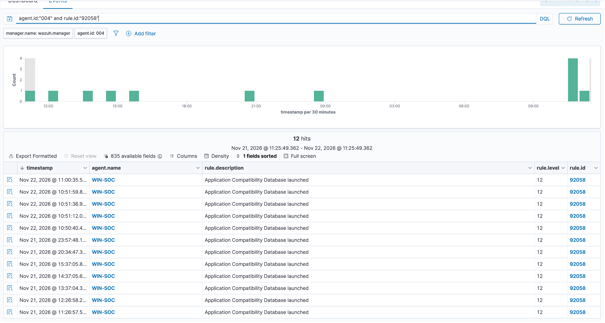
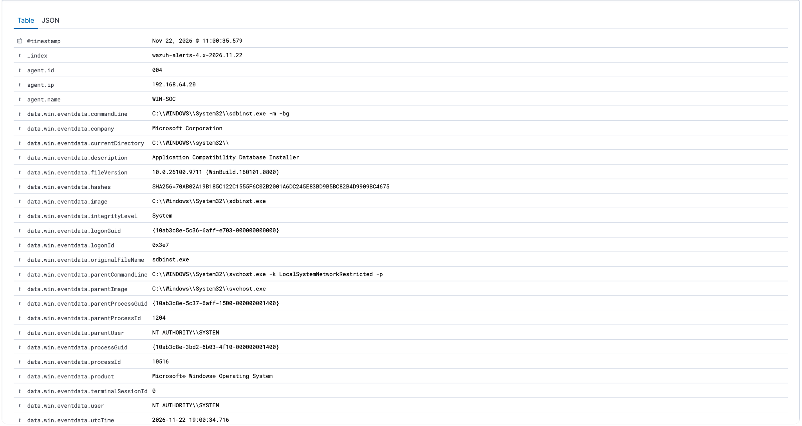

# Module 06: Customer Operations

**Project:** [Wazuh Operations Lab](../README.md)  
**Module:** Customer Operations  
**Environment:** Wazuh 4.14.6 | Docker | Windows 11 ARM64 | WIN-SOC  
**Date:** November 22, 2026  
**Case ID:** M06-001  
**Customer:** CORP-A (Fictional)  
**Status:** Laboratory Exercise Completed  
**Assessment:** Partially demonstrated within the tested scope  
**Case Disposition:** Open, Pending Validation

## 1. Objective

The objective was to practise MSSP SOC customer operations using an existing Wazuh laboratory environment.

The exercise covered endpoint monitoring validation, alert intake, process investigation, evidence correlation, severity assessment, simulated SLA management, internal analyst reporting, customer communication, and case disposition.

All activities were conducted in a home lab using a fictional customer scenario.

No real customer tenancy, contractual SLA, or production MSSP operations were involved.

## 2. Investigation Scenario

The fictional customer CORP-A was assigned the existing WIN-SOC endpoint for a simulated security monitoring case.

Wazuh generated repeated alerts associated with the Windows Application Compatibility Database Installer.

The selected detection was:

| Field | Value |
|---|---|
| Case ID | M06-001 |
| Customer | CORP-A |
| Endpoint | WIN-SOC |
| Agent ID | 004 |
| Wazuh Rule | 92058 |
| Rule Description | Application Compatibility Database launched |
| Rule Level | 12 |
| MITRE ATT&CK | T1546.011 Application Shimming |

The investigation aimed to determine whether the observed activity was consistent with legitimate Windows operations or required additional security investigation.

## 3. Lab Environment

| Component | Configuration |
|---|---|
| Deployment | Wazuh single node |
| Wazuh Version | 4.14.6 |
| Deployment Platform | Docker |
| Endpoint | WIN-SOC |
| Operating System | Windows 11 ARM64 |
| Agent Version | 4.14.9 |
| Agent ID | 004 |
| Event Source | Windows Sysmon |
| Primary Event | Event ID 1 |
| Investigation Interface | Wazuh Threat Hunting |
| Customer Context | Fictional CORP-A |

## 4. Endpoint Monitoring Validation

The investigation began by verifying monitoring availability through the Wazuh endpoint inventory.

Two agents were displayed as Active.

| Agent | ID | Status |
|---|---|---|
| WIN-SOC | 004 | Active |
| ubuntu-lab | 001 | Active |

WIN-SOC also showed a recent agent keep alive.

### Evidence 01: Endpoint Monitoring


**Observation:** WIN-SOC was connected to the Wazuh Manager.

**Interpretation:** The endpoint was available for monitoring.

**Limitation:** Agent connectivity alone does not guarantee complete security telemetry coverage.

## 5. Security Alert Intake

Wazuh Threat Hunting was used to retrieve events associated with WIN-SOC.

The query was:

```text
agent.id:"004"
```

The initial 24 hour search returned 1,478 matching alerts.

The event table included general process creation alerts and a higher level detection associated with application compatibility database execution.

### Evidence 02: Alert Retrieval


**Observation:** Wazuh was receiving and processing events from the endpoint.

**Interpretation:** The available alerts provided an initial investigation starting point.

**Decision:** Rule 92058 was selected for further examination.

## 6. Detection Validation

A focused query was executed:

```text
agent.id:"004" and rule.id:"92058"
```

The selected 24 hour window returned 12 matching alerts.

### Evidence 03: Rule 92058



A matching alert was expanded to examine its Sysmon fields.

| Field | Verified Value |
|---|---|
| Image | C:\Windows\System32\sdbinst.exe |
| Command Line | C:\WINDOWS\System32\sdbinst.exe -m -bg |
| User | NT AUTHORITY\SYSTEM |
| Integrity Level | System |
| Parent Image | C:\Windows\System32\svchost.exe |
| Parent Process ID | 1204 |
| Process ID | 10516 |
| Sysmon Event ID | 1 |
| Sysmon Record ID | 275699 |

### Evidence 04: Process Creation Details



**Observation:** The Windows Application Compatibility Database Installer executed under SYSTEM.

**Interpretation:** The executable path, account, and reported parent were consistent with a possible Windows system operation.

**Unknown:** The exact reason for execution and the initiating service remained unverified.

## 7. Parent Process Investigation

The parent process GUID was used to search for the original `svchost.exe` creation record.

The local Sysmon search returned no matching event.

A corresponding Wazuh search over seven days also returned no matching process creation record.

The investigation therefore continued using available process and service information.

The running process associated with PID 1204 showed:

| Field | Verified Value |
|---|---|
| Process | svchost.exe |
| Process ID | 1204 |
| Creation Date | November 19, 2026, 12:29:43 PM |
| Executable Path | C:\WINDOWS\System32\svchost.exe |
| Command Line | svchost.exe -k LocalSystemNetworkRestricted -p |

The current process started before the investigated alert.

Its command line and executable path matched the parent information in the Wazuh event.

However, the original parent creation record was unavailable, preventing independent historical process GUID validation.

## 8. Windows Service Correlation

The running parent process was associated with multiple Windows services.

One identified service was the Program Compatibility Assistant Service.

| Field | Verified Value |
|---|---|
| Service Name | PcaSvc |
| Display Name | Program Compatibility Assistant Service |
| State | Running |
| Start Mode | Auto |
| Service Account | LocalSystem |
| Host Process | svchost.exe |
| Process ID | 1204 |

### Evidence 05: Service Configuration


**Observation:** PcaSvc was running within the same service host process identified by PID 1204.

**Correlation:** The service configuration matched the reported parent process command line.

**Interpretation:** The evidence supported a possible Windows compatibility service explanation.

**Limitation:** Multiple services shared PID 1204. The available telemetry did not establish that PcaSvc specifically initiated sdbinst.exe.

## 9. Repeated Process Execution Analysis

Two Rule 92058 events were compared.

| Field | Event A | Event B |
|---|---|---|
| Image | sdbinst.exe | sdbinst.exe |
| Arguments | -m -bg | -m -bg |
| User | SYSTEM | SYSTEM |
| Parent | svchost.exe | svchost.exe |
| Parent PID | 1204 | 1204 |
| Child PID | 10516 | 1088 |
| Parent Process GUID | Matching | Matching |
| SHA256 | Matching | Matching |

The two records represented separate process instances with consistent execution characteristics.

**Observation:** Both events showed the same executable, arguments, account, and reported parent process instance.

**Interpretation:** The activity followed a repeatable execution pattern.

**Limitation:** A repeatable pattern does not independently establish legitimacy or authorization.

A discrepancy between dashboard and source timestamps was also observed in one event. The exact chronology was not independently resolved.

## 10. Executable Signature Validation

The executable was checked using Windows PowerShell.

```powershell
Get-AuthenticodeSignature "C:\Windows\System32\sdbinst.exe" | Select-Object Status, StatusMessage, @{Name='Signer';Expression={$_.SignerCertificate.Subject}} | Format-List
```

The output showed:

| Field | Result |
|---|---|
| Status | Valid |
| Status Message | Signature verified |
| Signer | Microsoft Windows, Microsoft Corporation |

### Evidence 06: Digital Signature


**Finding:** The file currently present on WIN-SOC had a valid Microsoft digital signature.

**Limitation:** A valid digital signature does not establish whether the observed execution was authorized.

## 11. SHA256 Hash Validation

The executable hash was calculated using:

```powershell
Get-FileHash "C:\Windows\System32\sdbinst.exe" -Algorithm SHA256 | Format-List
```

The resulting SHA256 was:

```text
70AB02A19B185C122C1555F6C02B2001A6DC245E83BD9B5BC82B4D9909BC4675
```

The value matched the executable hash recorded in the reviewed Sysmon events.

### Evidence 07: SHA256 Correlation


**Observation:** The calculated file hash matched the hash captured in Wazuh.

**Interpretation:** The hash comparison strengthened confidence in the executable identity associated with the detection.

**Limitation:** Matching hashes establish file identity, not execution authorization.

## 12. Simulated Customer Severity Assessment

The alert was evaluated using the available technical evidence.

**Wazuh Rule Level:** 12

**Provisional Customer Priority:** Medium

The Medium priority was selected as a training assessment because compromise and customer impact were not established, while the execution origin remained partially unresolved.

This priority was not assigned in a real MSSP ticketing system.

## 13. Simulated SLA Management

The following acknowledgment targets were used for training.

| Priority | Acknowledgment Target |
|---|---|
| Critical | 15 minutes |
| High | 30 minutes |
| Medium | 2 hours |
| Low | 8 hours |

### Case M06-001 SLA Exercise

| Field | Simulated Value |
|---|---|
| Customer | CORP-A |
| Priority | Medium |
| Assumed Receipt Time | 11:00 AM |
| Acknowledgment Target | 2 hours |
| Calculated Deadline | 1:00 PM |
| Example Acknowledgment | 11:20 AM |
| Example Outcome | Target Met |

The intake and acknowledgment times were fictional exercise values.

No real customer acknowledgment was performed.

**Assessment:** SLA calculation demonstrated through simulation. Actual operational SLA performance was not tested.

## 14. Internal SOC Handoff

An internal technical summary was prepared for a simulated incoming analyst.

**Case ID:** M06-001  
**Customer:** CORP-A  
**Endpoint:** WIN-SOC  
**Priority:** Medium, Provisional  
**Status:** Open, Pending Validation

Wazuh Rule 92058 detected repeated sdbinst.exe executions on WIN-SOC.

The reviewed records showed SYSTEM execution, matching command line arguments, and the same reported svchost.exe parent process instance.

The executable had a valid Microsoft signature and a SHA256 hash matching the original Sysmon evidence.

The running parent process hosted multiple Windows services, including PcaSvc.

The exact initiating service and execution authorization remained unverified.

**Recommended Action:** Validate the expected execution purpose before recommending final case closure.

## 15. Customer Communication

A nontechnical customer update was prepared for the fictional CORP-A scenario.

### Simulated Customer Update

We detected repeated activity involving a Windows system component on your computer.

Our investigation found characteristics consistent with normal Windows operations, and no evidence confirming a compromise was identified within the reviewed activity.

Additional validation would be required to establish the precise origin and expected purpose of the execution.

No real customer message was sent.

## 16. Investigation Findings

### Observation

Wazuh detected repeated sdbinst.exe executions under SYSTEM.

The reported parent process was svchost.exe.

### Correlation

Two reviewed events showed matching executable paths, command line arguments, parent process GUIDs, user context, and executable hashes.

A valid Microsoft signature was confirmed.

The reported parent process hosted Windows services, including PcaSvc.

### Interpretation

The reviewed evidence supported a plausible legitimate Windows compatibility operation.

No malicious execution was confirmed.

### Unknowns

The exact initiating service was not established.

Execution authorization was not independently confirmed.

The original parent process creation record was unavailable.

A timestamp discrepancy remained unresolved.

These evidence limitations prevented a conclusive benign classification.

## 17. Final Case Disposition

**Case ID:** M06-001  
**Customer:** CORP-A (Fictional)  
**Technical Exercise:** Completed  
**Case Classification:** Unresolved  
**Case Status:** Open, Pending Validation  
**Confirmed Compromise:** Not Established  
**Confirmed Authorization:** Not Established

The investigation was completed within the agreed laboratory scope.

The case was not closed as confirmed benign because the available evidence did not fully establish authorization and initiating service attribution.

## 18. MSSP Competency Assessment

| Competency | Assessment |
|---|---|
| Endpoint Monitoring Validation | Demonstrated |
| Alert Intake | Demonstrated |
| Process Investigation | Demonstrated Within Reviewed Scope |
| Evidence Correlation | Demonstrated |
| Customer Severity Assessment | Partially Demonstrated |
| Simulated SLA Calculation | Demonstrated |
| Actual SLA Acknowledgment | Not Yet Tested |
| Internal Analyst Handoff | Demonstrated With Guidance |
| Customer Communication | Demonstrated With Guidance |
| Real Customer Operations | Not Yet Tested |
| Multi-Customer Case Handling | Not Yet Tested |

All demonstrated activities were performed within a controlled home lab.

No production MSSP experience or genuine customer multitenancy was claimed.

## 19. Lessons Learned

### Detection Is Not Confirmation

A higher Wazuh rule level does not independently establish compromise or customer impact.

### Process Context Is Essential

Executable paths, command lines, user accounts, parent processes, and process GUIDs help explain observed activity.

### Integrity Does Not Establish Intent

A valid Microsoft signature and matching SHA256 confirm important executable characteristics but do not prove authorization.

### Evidence Gaps Must Be Preserved

Unknowns should remain documented rather than being replaced by assumptions.

### Customer Reporting Requires Clarity

Technical investigation details must be translated into understandable customer updates without unsupported claims.

### SLA Practice Must Remain Transparent

A simulated SLA calculation does not represent a real contractual acknowledgment or operational performance.

## 20. Module Assessment

**Module:** 06 Customer Operations  
**Exercise Status:** Completed  
**Case Status:** Open, Pending Validation  
**Assessment:** Partially Demonstrated Within Tested Scope

This module provided practical experience with Wazuh alert investigation, evidence correlation, simulated customer prioritization, SLA calculation, internal handoff, and customer communication.

The investigation conclusions remain limited to the verified evidence.

## 21. Navigation

[Project Home](../README.md) | [Previous Module: Joint SOC × DFIR Investigations](../module-05-soc-investigations/README.md) | [Continue to Module 07: Blind Assessment](../module-07-blind-assessment/README.md)
