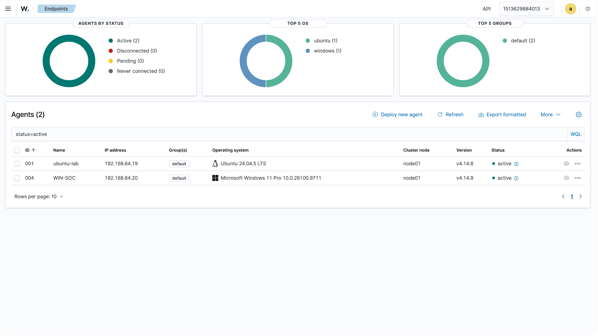
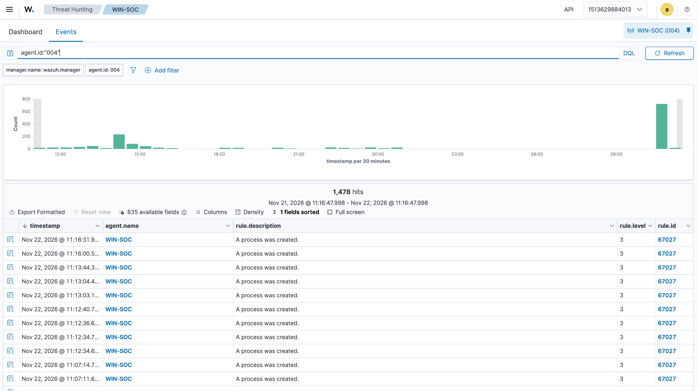
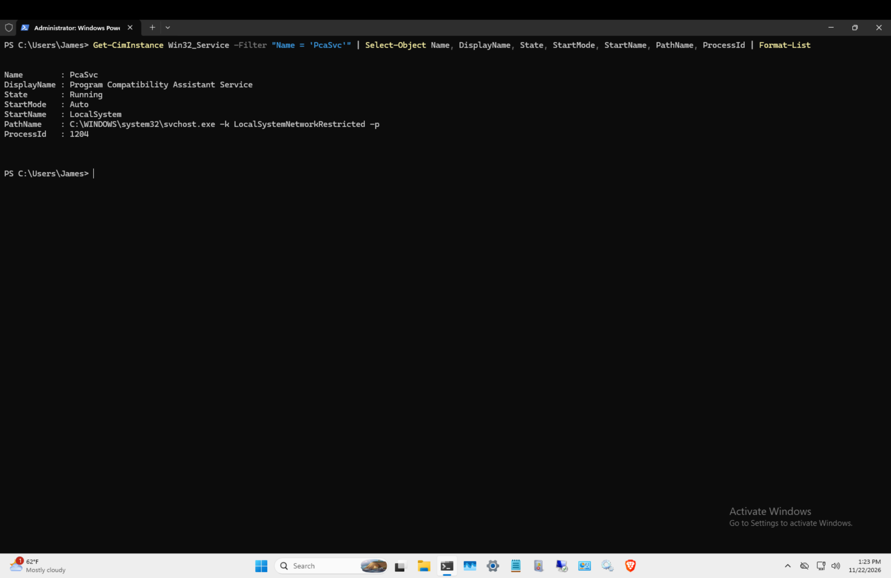
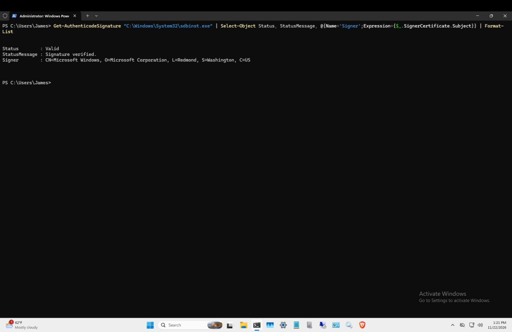
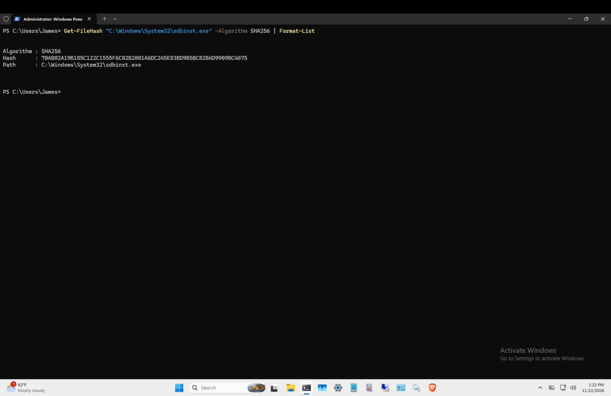

# Module 06: Customer Operations

**Project:** [Wazuh Operations Lab](../README.md)  
**Module:** Customer Operations  
**Environment:** Wazuh 4.14.6 | Docker | Windows 11 ARM64 | WIN-SOC  
**Investigation Date:** November 22, 2026  
**Case ID:** M06-001  
**Customer:** CORP-A (Fictional)  
**Status:** Laboratory Exercise Completed  
**Assessment:** Partially demonstrated within the tested scope  
**Case Disposition:** Unresolved — Further Validation Required

## 1. Objective

Practise the operational responsibilities of an MSSP SOC analyst using a controlled Wazuh laboratory environment.

The exercise focused on:

1. Validating endpoint monitoring availability.
2. Retrieving and reviewing customer security alerts.
3. Investigating a potentially suspicious Windows process.
4. Assessing alert severity and prioritization.
5. Practising simulated SLA acknowledgment management.
6. Correlating technical evidence.
7. Preparing an internal analyst handoff.
8. Communicating findings to a nontechnical customer.
9. Documenting the case disposition and remaining evidence gaps.

The exercise used a fictional customer scenario.

No real customer tenancy, contractual SLA, or production MSSP ticket was involved.

## 2. Simulated MSSP Scenario

**Customer:** CORP-A  
**Case:** M06-001  
**Monitored Endpoint:** WIN-SOC  
**Wazuh Agent:** 004  
**Detection:** Application Compatibility Database launched  
**Rule ID:** 92058  
**Rule Level:** 12

Wazuh detected repeated execution of the Windows Application Compatibility Database Installer.

The activity was investigated to determine whether it represented expected Windows functionality or potentially unauthorized execution.

The case also served as a simulated customer operations exercise involving case intake, prioritization, SLA reasoning, technical reporting, and customer communication.

CORP-A is a fictional customer label. The Wazuh deployment did not provide real customer multitenancy.

## 3. Lab Environment

| Component | Configuration |
|---|---|
| Wazuh deployment | Single-node Docker |
| Wazuh version | 4.14.6 |
| Endpoint | WIN-SOC |
| Operating system | Windows 11 Pro ARM64 |
| Wazuh agent | 4.14.9 |
| Agent ID | 004 |
| Endpoint telemetry | Windows Sysmon |
| Primary event | Sysmon Event ID 1 |
| Investigation interface | Wazuh Threat Hunting |
| Customer environment | Fictional CORP-A |
| Case management | Simulated |

## 4. Stage 01: Endpoint Monitoring Validation

The investigation began by checking the Wazuh endpoint inventory.

The dashboard showed two active agents:

- WIN-SOC, agent ID 004.
- ubuntu-lab, agent ID 001.

The WIN-SOC agent was confirmed as Active.

The endpoint details also showed a recent agent keep-alive.

### Evidence 01: Endpoint Monitoring Status



**Observation:** WIN-SOC was reporting an active connection to Wazuh.

**Interpretation:** The endpoint was available for monitoring. However, agent connectivity alone does not prove that every possible telemetry source was functioning.

**Outcome:** Monitoring availability verified.

## 5. Stage 02: Security Alert Retrieval

Wazuh Threat Hunting was used to retrieve events associated with WIN-SOC.

The following search was used:

```text
agent.id:"004"
```

The initial 24-hour search returned 1,478 matching alerts.

The event table contained several process creation events and a higher-level alert associated with application compatibility database execution.

Rule 92058 was selected for further investigation.

### Evidence 02: Wazuh Security Alert Retrieval



**Observation:** Wazuh was receiving and processing security events from WIN-SOC.

**Interpretation:** The alert table provided candidate events for investigation. Alert volume alone was not sufficient to determine malicious activity.

## 6. Stage 03: Alert Identification and Initial Triage

A focused search was performed:

```text
agent.id:"004" and rule.id:"92058"
```

The search returned 12 matching alerts within the selected 24-hour window.

| Field | Verified value |
|---|---|
| Rule ID | 92058 |
| Rule Description | Application Compatibility Database launched |
| Rule Level | 12 |
| Agent | WIN-SOC |
| Source | Sysmon Event ID 1 |
| Matching alerts | 12 |
| MITRE ATT&CK | T1546.011 — Application Shimming |

A matching event was opened for detailed analysis.

### Evidence 03: Wazuh Rule 92058


### Process Creation Evidence

The reviewed event contained the following values:

| Field | Verified value |
|---|---|
| Executable | `C:\Windows\System32\sdbinst.exe` |
| Command Line | `C:\WINDOWS\System32\sdbinst.exe -m -bg` |
| User | `NT AUTHORITY\SYSTEM` |
| Integrity Level | System |
| Parent Image | `C:\Windows\System32\svchost.exe` |
| Parent Process ID | 1204 |
| Process ID | 10516 |
| Sysmon Record ID | 275699 |

### Evidence 04: Process Creation Details


**Observation:** `sdbinst.exe` executed under SYSTEM with `svchost.exe` reported as its parent.

**Interpretation:** The process path and execution context were consistent with a possible Windows compatibility operation.

**Unknown:** The exact initiating service and authorization of the execution had not been established.

## 7. Stage 04: Process Ancestry and Correlation

The parent process GUID was used to search for the original Sysmon Event ID 1 record associated with `svchost.exe`.

No matching original parent creation record was returned from the local Sysmon search.

A corresponding Wazuh search over seven days also returned no result.

The investigation continued using available process information.

### Parent Process Validation

The running `svchost.exe` instance reported:

| Field | Verified value |
|---|---|
| Process | `svchost.exe` |
| Process ID | 1204 |
| Creation Date | November 19, 2026, 12:29:43 PM |
| Executable Path | `C:\WINDOWS\System32\svchost.exe` |
| Command Line | `svchost.exe -k LocalSystemNetworkRestricted -p` |

The current process started before the reviewed November 22 detection.

Its executable path and command line matched the historical parent information.

### Service Context

The running PID 1204 hosted multiple Windows services.

One was:

**PcaSvc — Program Compatibility Assistant Service**

The service configuration showed:

| Field | Verified value |
|---|---|
| Name | PcaSvc |
| Display Name | Program Compatibility Assistant Service |
| State | Running |
| Start Mode | Auto |
| Start Account | LocalSystem |
| Host Process | svchost.exe |
| Process ID | 1204 |

### Evidence 05: Service Configuration



**Observation:** PcaSvc was hosted within the same reported service-host process.

**Interpretation:** This supported a possible Windows compatibility-service explanation.

**Limitation:** Multiple services shared PID 1204. The evidence did not establish that PcaSvc specifically initiated `sdbinst.exe`.

## 8. Stage 05: Repeated Execution Comparison

Two Rule 92058 events were compared.

| Field | First reviewed event | Second reviewed event |
|---|---|---|
| Image | sdbinst.exe | sdbinst.exe |
| Arguments | `-m -bg` | `-m -bg` |
| User | SYSTEM | SYSTEM |
| Parent | svchost.exe | svchost.exe |
| Parent PID | 1204 | 1204 |
| Child PID | 10516 | 1088 |
| Parent Process GUID | Matching | Matching |
| SHA256 | Matching | Matching |

The records represented separate process executions with consistent executable, account, command-line, and parent information.

**Finding:** The executions shared a repeatable process creation pattern.

**Limitation:** Consistency alone did not establish whether the activity was authorized.

The investigation also identified a discrepancy between the displayed Wazuh timestamp and source timestamp values in one reviewed event. The exact event chronology therefore remained subject to timestamp validation.

## 9. Stage 06: Executable Integrity Validation

Additional read-only checks were performed against the executable on WIN-SOC.

### Digital Signature

The following command was executed:

```powershell
Get-AuthenticodeSignature "C:\Windows\System32\sdbinst.exe" | Select-Object Status, StatusMessage, @{Name='Signer';Expression={$_.SignerCertificate.Subject}} | Format-List
```

Results:

| Field | Verified result |
|---|---|
| Signature Status | Valid |
| Status Message | Signature verified |
| Signer | Microsoft Windows, Microsoft Corporation |

### Evidence 06: Digital Signature Verification



### SHA256 Hash Correlation

The file hash was calculated using:

```powershell
Get-FileHash "C:\Windows\System32\sdbinst.exe" -Algorithm SHA256 | Format-List
```

The resulting SHA256 was:

```text
70AB02A19B185C122C1555F6C02B2001A6DC245E83BD9B5BC82B4D9909BC4675
```

The value matched the SHA256 recorded in the reviewed Wazuh process creation events.

### Evidence 07: SHA256 Verification



**Observation:** The executable currently present on disk had a valid Microsoft signature and matched the hash recorded by Sysmon.

**Interpretation:** These findings strengthened confidence in the executable's identity.

**Limitation:** A legitimate signed Windows executable may still be used for unauthorized purposes. File authenticity does not establish execution authorization.

## 10. Stage 07: Simulated MSSP Severity and SLA Management

The case was used to practise customer priority assessment and acknowledgment deadline calculation.

### Severity Assessment

**Wazuh Rule Level:** 12  
**Provisional Customer Priority:** Medium

The provisional priority was based on the available investigation context:

- A higher-level Wazuh detection was generated.
- No confirmed compromise was established.
- Several characteristics were consistent with legitimate Windows behavior.
- The execution's exact initiating service and authorization remained unresolved.

This was a training assessment rather than an actual customer priority assignment.

### Simulated SLA Targets

| Priority | Acknowledgment Target |
|---|---|
| Critical | 15 minutes |
| High | 30 minutes |
| Medium | 2 hours |
| Low | 8 hours |

### Simulated Case Timing

| Field | Training value |
|---|---|
| Fictional customer | CORP-A |
| Case ID | M06-001 |
| Priority | Medium, provisional |
| Assumed intake time | November 22, 2026, 11:00 AM |
| Acknowledgment target | 2 hours |
| Calculated deadline | 1:00 PM |
| Example acknowledgment time | 11:20 AM |
| Example outcome | Target met |

The intake and acknowledgment times were hypothetical training values.

No actual customer ticket was acknowledged.

**Outcome:** SLA calculation and acknowledgment reasoning practised. Operational SLA compliance was not demonstrated.

## 11. Stage 08: Internal SOC Handoff

An internal handoff was prepared to communicate the technical findings to another analyst.

### Internal Case Summary

**Case:** M06-001  
**Customer:** CORP-A (Fictional)  
**Endpoint:** WIN-SOC  
**Priority:** Medium (Provisional)  
**Status:** Investigation Open — Pending Validation

Wazuh Rule 92058 detected repeated `sdbinst.exe` executions.

The reviewed records showed consistent command-line arguments, SYSTEM execution, and the same reported `svchost.exe` parent process instance.

The executable's digital signature was valid and its SHA256 matched the recorded Sysmon telemetry.

The running parent process hosted multiple services, including PcaSvc.

However, the exact initiating service was not established and execution authorization was not independently confirmed.

**Recommended Next Action:** Validate the expected system or administrative purpose before closing the case.

## 12. Customer-Facing Communication

The technical findings were also converted into a short nontechnical update for the fictional customer.

### Simulated CORP-A Customer Update

> We detected repeated activity involving a Windows system component on your computer.
>
> Our initial investigation found characteristics consistent with normal Windows operations, and we have not identified evidence confirming a compromise.
>
> However, we are continuing to verify the activity's origin before reaching a final conclusion.

This communication avoided unsupported claims of compromise or confirmed benign activity.

It also distinguished what the investigation established from what remained unresolved.

No actual customer message was sent.

## 13. Final Case Assessment

### Observed

Wazuh detected repeated execution of `sdbinst.exe`.

The reviewed process creation events showed SYSTEM execution and a reported `svchost.exe` parent.

### Correlated

Two reviewed executions had matching command-line arguments, parent process GUIDs, user context, and executable hashes.

The current executable had a valid Microsoft digital signature.

The running parent PID hosted Windows services, including PcaSvc.

### Interpretation

The evidence supported a plausible legitimate Windows compatibility-related explanation.

No malicious activity was confirmed within the reviewed evidence.

### Unknowns

- The exact service responsible for initiating `sdbinst.exe`.
- Whether every reviewed execution was expected and authorized.
- The original parent process creation record.
- The reason for the observed timestamp discrepancy.
- Whether related activity outside the reviewed scope would change the assessment.

### Case Disposition

**Technical Exercise:** Completed within the tested scope  
**Customer Case:** Open — Pending Validation  
**Final Classification:** Unresolved  
**Confirmed Compromise:** Not Established  
**Confirmed Authorization:** Not Established

The case was not closed as a confirmed benign true positive because authorization and exact execution origin remained unverified.

This is an evidence-based limitation rather than a failed exercise.

## 14. MSSP Competencies Practised

| Competency | Assessment |
|---|---|
| Endpoint monitoring validation | Demonstrated |
| Security alert intake | Demonstrated |
| Process execution investigation | Demonstrated within reviewed scope |
| Severity assessment | Partially demonstrated |
| SLA calculation | Demonstrated through simulation |
| Actual SLA acknowledgment | Not tested |
| Internal analyst handoff | Demonstrated with guidance |
| Customer-facing reporting | Demonstrated with guidance |
| Real customer communication | Not tested |
| Real multi-customer case handling | Not tested |
| Final benign or malicious attribution | Not established |

The fictional CORP-A scenario did not provide evidence of genuine MSSP employment, customer operations, or Wazuh multitenancy.

## 15. Lessons Learned

### Monitoring Availability Is Not Complete Telemetry Assurance

An Active agent indicates connectivity, but relevant events must still be verified.

### Alert Level Does Not Establish Customer Impact

Wazuh detection levels support triage but do not automatically determine customer severity.

### Process Context Matters

Executable paths, command lines, parent processes, accounts, process GUIDs, and hashes must be interpreted together.

### Signed Executables Can Still Be Abused

A valid digital signature supports executable identity, not authorization of its behavior.

### Evidence Gaps Must Be Reported

An analyst should distinguish what was observed, what was inferred, and what could not be established.

### Internal and Customer Reports Serve Different Audiences

Technical handoffs preserve investigation detail.

Customer updates communicate the situation, potential impact, next steps, and uncertainty in accessible language.

### SLA Simulations Are Not Real SLA Performance

A calculated deadline demonstrates understanding of acknowledgment targets.

It does not prove actual service delivery within a contractual SLA.

## 16. Final Assessment

**Module:** 06 — Customer Operations  
**Case:** M06-001  
**Laboratory Exercise:** Completed  
**Case Disposition:** Open — Pending Validation  
**Assessment:** Partially demonstrated within the tested scope

The exercise demonstrated Wazuh-based alert investigation, endpoint evidence correlation, simulated case prioritization, SLA calculation, technical handoff, and nontechnical customer communication.

The investigation preserved unresolved evidence gaps without fabricating a confirmed benign or malicious outcome.

## 17. Navigation

[Project Home](../README.md) | [Previous Module: Joint SOC × DFIR Investigations](../module-05-soc-investigations/README.md) | [Continue to Module 07: Blind Assessment](../module-07-blind-assessment/README.md)
